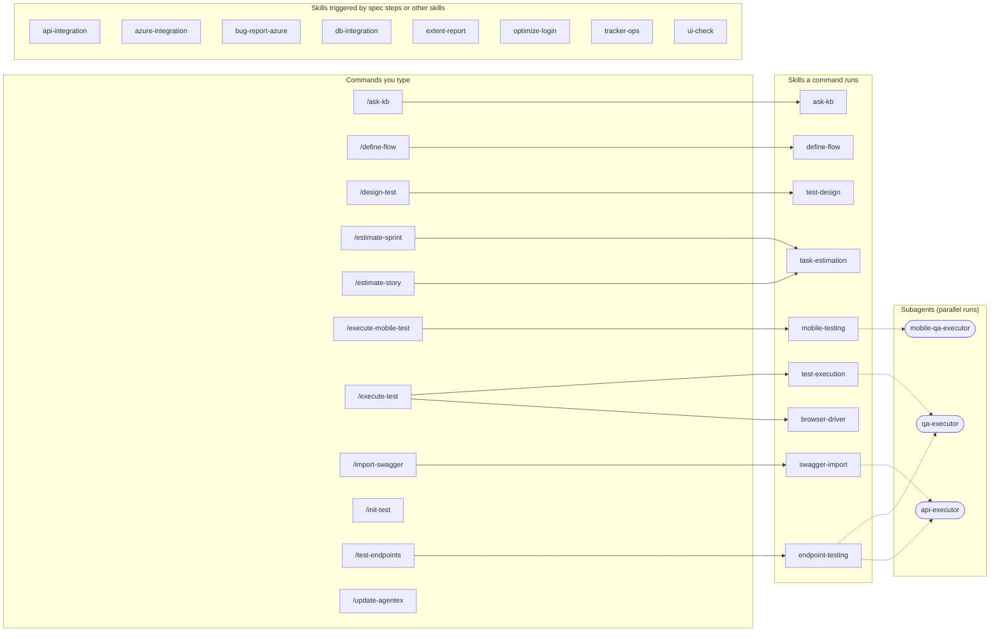
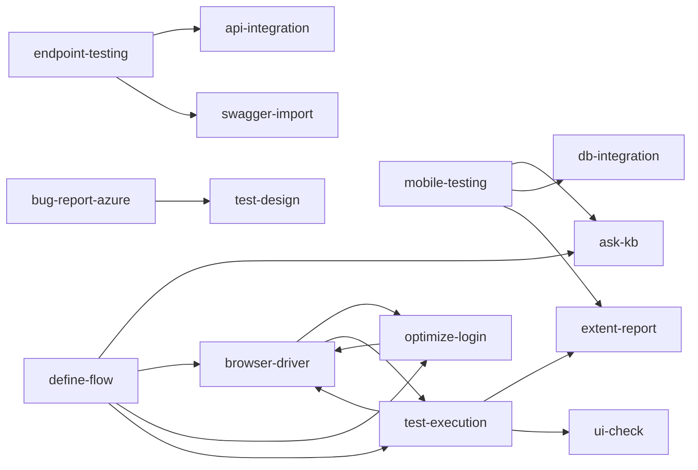

# AgenTeX

**Agentic QA for Claude Code — an agent plans, runs, and reports your tests so you don't click through them by hand.**

[](./CHANGELOG.md)
[](./LICENSE)
[](https://docs.anthropic.com/en/docs/claude-code)
[](https://www.npmjs.com/package/@playwright/cli)
[](https://appium.io/docs/en/latest/)
[](https://azure.microsoft.com/en-us/products/devops)

AgenTeX (Agentic Test eXecution) takes manual test execution off your plate. Instead of clicking the
same scenarios by hand, an agent plans them, drives a **real browser** via
[`@playwright/cli`](https://www.npmjs.com/package/@playwright/cli) or a **real native mobile
app** via [Appium](https://appium.io/docs/en/latest/), captures screenshot/log evidence,
and produces a consolidated defect report — either **sequentially** (human-in-the-loop) or in
**parallel** (autonomous, one session per spec file). It **never modifies your application code**.

## [Getting Started](./docs/getting-started.md)

New here? **[Getting Started](./docs/getting-started.md)** walks you through install → browser driver
→ `/init-test` → permissions → first run. The short version:

```
/plugin marketplace add MhmdElGazzar/elgazzar-plugins
/plugin install agentex@elgazzar-plugins
/init-test
/execute-test https://example.com
```

## Features — how each one works

| Feature | How it works | Docs |
|---------|--------------|------|
| **Test execution** | An agent plans scenarios and runs each step through its driver — a real `playwright-cli` browser, your APIs, or your database (API/DB-only specs need no browser) — capturing evidence and reporting defects, sequential (approve each step) or parallel (one `qa-executor` subagent per spec file). | [test-execution](./docs/test-execution.md) |
| **Define flow** | `/define-flow` builds a spec by doing it: an agent-led session proposes each step, executes it live the moment you agree, and you assert the real outcome before the next step — the saved spec follows the normal conventions and runs unmodified via `/execute-test`. Point it at an existing spec to walk it through and clarify it. | [define-flow](./docs/define-flow.md) |
| **Mobile testing** | Same flow for native Android/iOS apps, driven through a real [Appium](https://appium.io/docs/en/latest/) session (raw WebDriver REST or a bundled `webdriverio` wrapper) — sequential or parallel (one `mobile-qa-executor` subagent per spec file, per device/emulator). | [mobile-testing](./docs/mobile-testing.md) |
| **API & DB steps** | `api:` / `db:` scenario steps run **only** the named, parameterized requests/queries in your `integration/` catalog — the agent never composes its own SQL or HTTP; DDL is refused. | [api-db-steps](./docs/api-db-steps.md) |
| **Ask the KB** | `kb:` steps (or `/ask-kb`) query your project's KB Ask API for advisory context — informs testing, **never** used as PASS/FAIL evidence. | [ask-kb](./docs/ask-kb.md) |
| **UI check steps** | `ui-check:` scenario steps compare the live page against a design baseline — a Figma frame (identifier only; file + token configured once) or a screenshot — in `exact` or `reference` mode; verdicts, warnings, and view-mismatch errors land in the reports with both images as evidence. | [ui-check](./docs/ui-check.md) |
| **Optimize login** | Pay a web app's login once per session: drive it live, verify by landmark (never by URL), save the browser session, and reload it into a fresh browser to continue. | [optimize-login](./docs/optimize-login.md) |
| **Tracker planning (Azure DevOps or Jira Cloud)** | `/estimate-story <ids>` and `/estimate-sprint` create the `[Testing]` tasks your `config/estimation.json` defines (Jira: sub-tasks with time tracking), proposed on the first run from your team's own last closed sprints, with abnormal values asked about on the same screen; `/design-test` turns story acceptance criteria (ACs) into linked test cases (Jira has no native Test Case type — you choose what to create) — both through bundled scripts over the tracker REST API (no `az`, no `acli`), validated fail-closed first, with **one** consolidated approval per flow. Fail-closed means that if validation (the checks every task or test case must pass, run before any write) fails, nothing is written to the board. | [azure-devops](./docs/azure-devops.md) · [jira](./docs/jira.md) |
| **Tracker bug filing (Azure DevOps or Jira Cloud)** | After a run, `bug-report-azure` files found defects as tracker **Bugs** through the same bundled scripts — recommends severity/priority, validates every field against your project's real values, links each bug to its parent User Story, validates & attaches screenshots, optionally fails the related test case (ADO); all writes behind **one** approval, with an exact per-write ledger if anything fails partway. | [azure-devops](./docs/azure-devops.md) · [jira](./docs/jira.md) |
| **HTML report** | At the end of a run, generates a standalone, self-contained `extent-report.html` dashboard (donut chart, status cards, expandable per-test-case steps). | [extent-report](./docs/extent-report.md) |
| **Configuration** | Three homes, one each: `config/project.json` (project settings), `environments/<env>.json` (targets, users, integrations), and a secrets-only `.env` — legacy keys-only `.env` projects still work untouched. After a plugin update, `/update-agentex` migrates a project to the new conventions, carrying your values. | [configuration](./docs/configuration.md) |
| **Standalone API tests** | `/test-endpoints` runs every cataloged endpoint's test cases in one pass, dispatching an `api-executor` subagent and reporting pass/fail per case. `/test-endpoints --edit` opens a local editor to review, fix and re-run cases. | [skills/endpoint-testing/SKILL.md](./skills/endpoint-testing/SKILL.md) |
| **Swagger/OpenAPI import** | `/import-swagger <path-or-url>` generates the API catalog + suite from a Swagger 2.0 / OpenAPI 3.x spec — mapping fields, skipping what it can't infer, and picking an auth scheme. `/import-swagger --wizard` walks you through it with real test data and four basic checks per endpoint. | [skills/swagger-import/SKILL.md](./skills/swagger-import/SKILL.md) |

See [docs/](./docs/) for the full reference on any feature.

## How it fits together

<!-- agentex:architecture:begin (generated by scripts/dev/architecture.js --write; do not edit) -->

### What you run, and what it uses

11 commands, 17 skills and 3 subagents. Solid arrows: a command runs a skill. Dotted arrows: work handed to a subagent.



### Which skill relies on which

An arrow means the skill reads the other skill's instructions or runs its scripts. Arrows both ways mark two skills that depend on each other.



<!-- agentex:architecture:end -->

## Usage at a glance

```
# Sequential (human-in-the-loop) — natural language:
Test https://example.com — the signup form: happy path plus empty and bad-email cases.

# Parallel (autonomous) — one subagent per spec file:
Run a parallel regression against https://example.com from the specs in test/suite1/.

# Slash commands:
/execute-test https://example.com
/define-flow https://example.com     # build a spec step by step, executing each step live
/execute-mobile-test suite1          # runs ./test/mobile-suite1/ (not ./test/suite1/)
/test-endpoints
/import-swagger ./openapi.json --name acme-api
/import-swagger --wizard ./openapi.json   # guided: real test data, basic checks, one approval
/test-endpoints --edit                    # local suite editor
/estimate-story 12345 12346
/estimate-sprint         # every story in the current sprint
/design-test 12345
/ask-kb acme-store: how does the checkout flow work?
/update-agentex        # after a plugin update: migrate this project to the new conventions
```

Every run writes to a timestamped `executions/execu_<timestamp>/` folder — `report.md`,
`extent-report.html`, per-session logs/screenshots, and a merged bug list.

## Contributing

New to the codebase? **[docs/contributing/](./docs/contributing/README.md)** teaches Claude
Code concepts from zero, AgenTeX's architecture, and walks through adding a skill end to end.
Open issues and PRs on the [GitHub repository](https://github.com/MhmdElGazzar/agentex).

## Contributors

- **Mohamed Elgazzar** — creator & maintainer
- **Marwah Zain**
- [**@mabdel130**](https://github.com/mabdel130) — `extent-report` skill (PR #1)
- [**@YoussefAbdellah2023**](https://github.com/YoussefAbdellah2023) — `extent-report` v2/v3, Jira and Figma integration work (PRs #5, #6, #7, #8, #11, #13, #14)
- [**@Hager-Helmy**](https://github.com/Hager-Helmy) — the `bug-report-azure` skill (PR #2) and its rebuild as one context/prepare/execute operation with deterministic duplicate ranking (PR #19)
- [**@MahmoudElSharkawy**](https://github.com/MahmoudElSharkawy) — annotated screenshots on filed Azure bugs (PR #20)
- [**@abdo-mohamed-ezzat**](https://github.com/abdo-mohamed-ezzat) — session login reuse (PR #17), multi-context flows RFC (#18)
- [**@MohamedAbdella**](https://github.com/MohamedAbdella) — multi-runtime support: native Codex and Copilot execution, guarded project installation and parallel agent coordination (PRs #22, #27, #28, #29). The host branches are generated from `main` using his host knowledge.

## License

MIT — see [LICENSE](./LICENSE).
