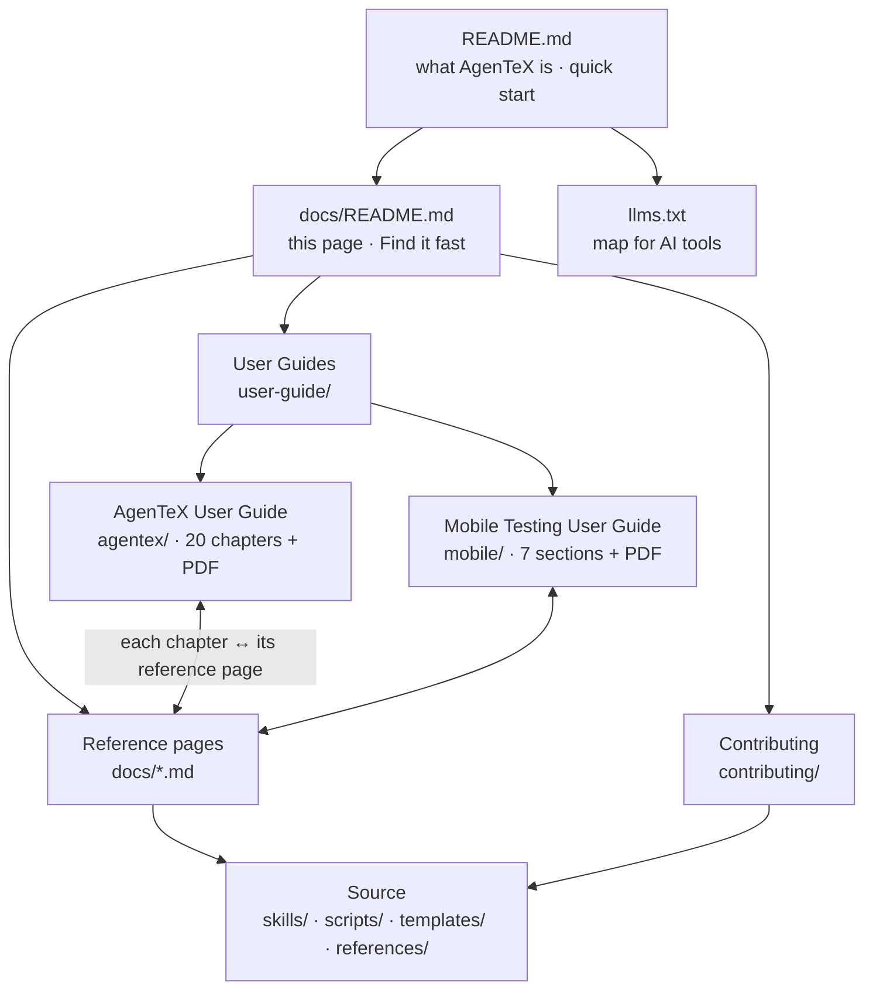
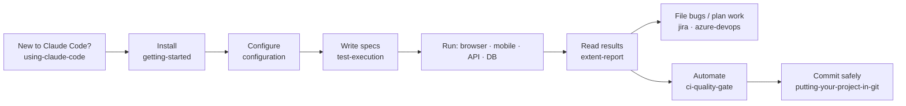
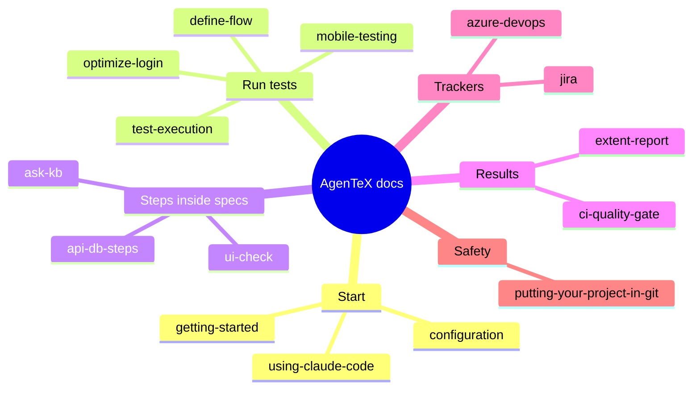

# AgenTeX Documentation

Detailed docs for each capability. Start with the [project README](../README.md) for install and a
quick tour.

This folder holds one reference page per feature (the table under [All pages](#all-pages)),
the step-by-step user guide in [`user-guide/`](./user-guide/README.md), and the contributor
docs in [`contributing/`](./contributing/README.md).

## How the docs fit together

The docs have three layers. Each layer links to the others, so from any page you can reach the
walkthrough, the full detail, or the code behind it.

| Layer | Answers | Where |
|-------|---------|-------|
| **Guide** | "What do I do, in order?" | [`user-guide/`](./user-guide/README.md): chapters with previous / next links |
| **Reference** | "What are all the options and rules?" | One page per feature in this folder; each starts with a link to its guide chapter |
| **Source** | "How does it work inside?" | `skills/<name>/SKILL.md` and the folder READMEs, linked from each reference page |

### The user's journey through the docs

### Which page covers which feature

## User guides

Walkthroughs to read in order, written in markdown (one file per chapter) and also exported as
PDF for offline reading:

| Guide | Read online | PDF | For |
|-------|-------------|-----|-----|
| AgenTeX User Guide | [20 chapters + glossary + cheat sheet](./user-guide/agentex/README.md) | [PDF](./user-guide/agentex/agentex-user-guide.pdf) | The whole framework, start to finish. |
| Mobile Testing User Guide | [7 sections](./user-guide/mobile/README.md) | [PDF](./user-guide/mobile/agentex-mobile-user-guide.pdf) | Native Android / iOS testing only: the short path. |

A guide chapter tells you what to do, in order; the reference pages below hold every option
and detail.

## Find it fast — "I want to…"

| I want to… | Run or write | Read |
|------------|--------------|------|
| Test a website in a browser | `/execute-test https://your-app.com` | [Test Execution](./test-execution.md) |
| Run a regression suite unattended | "Run a parallel regression … from the specs in test/suite1/" | [Test Execution](./test-execution.md) |
| Test an Android / iOS app | `/execute-mobile-test suite1` | [Mobile Testing](./mobile-testing.md) |
| Test APIs with no browser | `/test-endpoints` | [API & DB Steps](./api-db-steps.md) |
| Generate API tests from Swagger / OpenAPI | `/import-swagger --wizard ./openapi.json` | [API & DB Steps](./api-db-steps.md) |
| Check the database after a UI action | `db: sample-db.todo-by-title(title=qa-test-item)` | [API & DB Steps](./api-db-steps.md) |
| Write a spec by doing the flow live | `/define-flow https://your-app.com on uat` | [Define Flow](./define-flow.md) |
| Compare a page with a Figma design | `ui-check: figma 123:456 — mode: exact` | [UI Check](./ui-check.md) |
| Stop logging in on every test | `"login": { "mode": "session" }` in `config/project.json` | [Optimize Login](./optimize-login.md) |
| Ask the project knowledge base | `/ask-kb how does checkout work?` | [Ask the Knowledge Base](./ask-kb.md) |
| Estimate QA effort or design test cases on Jira | `/estimate-sprint` · `/design-test PROJ-12` | [Jira QA](./jira.md) |
| Do the same on Azure DevOps | `/estimate-story 12345` · `/design-test 12345` | [Azure DevOps QA](./azure-devops.md) |
| File the bugs a run found | "File the defects from the last run as bugs" | [Azure DevOps QA](./azure-devops.md) · [Jira QA](./jira.md) |
| Check Azure resources during a test | "Check if the latest deployment succeeded" | [Azure DevOps QA](./azure-devops.md) |
| Gate my CI/CD pipeline on test results | `node …/ci_gate.js --suite test/suite1/ --env uat` | [CI Quality Gate](./ci-quality-gate.md) |
| Open the HTML dashboard of a run | `executions/execu_<timestamp>/extent-report.html` | [Interactive HTML Report](./extent-report.md) |
| Set up URLs, users and secrets | `environments/<env>.json` and `.env` | [Configuration](./configuration.md) |
| Commit my test project safely | the secret scan and the optional pre-commit hook | [Putting your project in git](./putting-your-project-in-git.md) |

## All pages

| Doc | What it covers |
|-----|----------------|
| [Using Claude Code](./using-claude-code.md) | New to Claude Code itself? Start here — typing requests, slash commands, approving actions. |
| [Getting Started](./getting-started.md) | Install → browser driver → `/init-test` → permissions → first run. |
| [Test Execution](./test-execution.md) | The core flow — sequential vs. parallel modes, writing specs (browser, API, DB steps), output layout. |
| [Define Flow](./define-flow.md) | `/define-flow` — build a spec by doing it: each step executed live and asserted before the next is defined; also walks existing specs to clarify them. |
| [Mobile Testing](./mobile-testing.md) | Native Android/iOS app testing via Appium — sequential vs. parallel modes, capabilities, writing specs. |
| [API & DB Steps](./api-db-steps.md) | Catalog-only `api:` / `db:` steps inside test scenarios. |
| [Ask the Knowledge Base](./ask-kb.md) | `kb:` steps and the `/ask-kb` command (advisory only). |
| [UI Check](./ui-check.md) | `ui-check:` steps: compare the live page with a Figma frame or a baseline screenshot, in `exact` or `reference` mode. |
| [Optimize Login](./optimize-login.md) | Pay a web app's login cost once per session instead of once per test. |
| [Azure DevOps QA](./azure-devops.md) | `/estimate-story`, `/estimate-sprint`, `/design-test`, `bug-report-azure` bug filing, and Azure resource access. |
| [Jira QA](./jira.md) | The same tracker flows on Jira Cloud — setup, per-flow behavior, and the honest capability gaps. |
| [Interactive HTML Report](./extent-report.md) | The standalone `extent-report.html` dashboard. |
| [CI Quality Gate](./ci-quality-gate.md) | Invoke runs from your CI/CD pipeline: the `ci_gate.js` entry point, exit-code semantics (0/1/2), the public verdict JSON contract, pipeline templates, advisory vs blocking modes. |
| [Configuration](./configuration.md) | Environment variables, permissions, and secret handling. |
| [Putting your project in git](./putting-your-project-in-git.md) | What to commit and what stays local, setting a remote safely, the secret scan, the optional pre-commit hook, and fixing findings. |
| [User Guides](./user-guide/README.md) | Two step-by-step guides, each in its own folder with its PDF: the [AgenTeX User Guide](./user-guide/agentex/README.md) (20 chapters) and the [Mobile Testing User Guide](./user-guide/mobile/README.md). |
| [Contributing](./contributing/README.md) | For people changing AgenTeX itself: Claude Code concepts, architecture, adding a skill, conventions, testing, PR workflow. |
