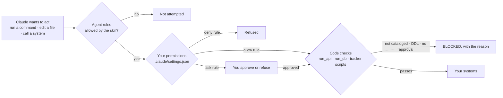
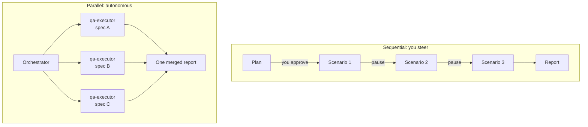
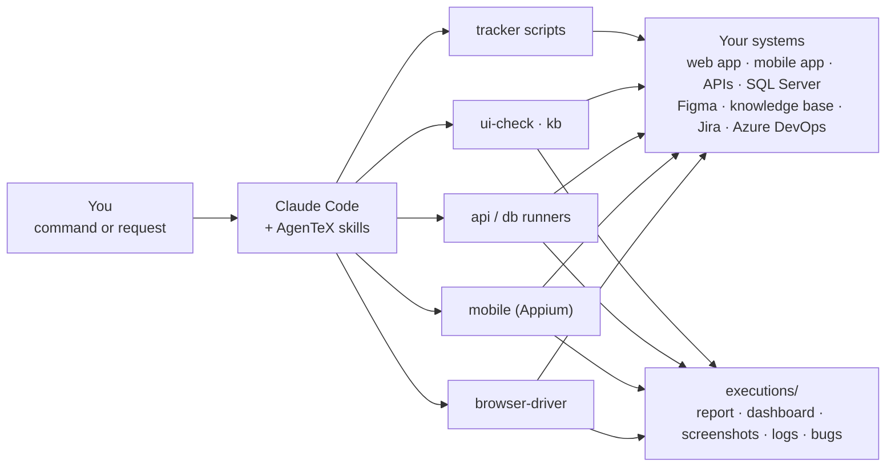
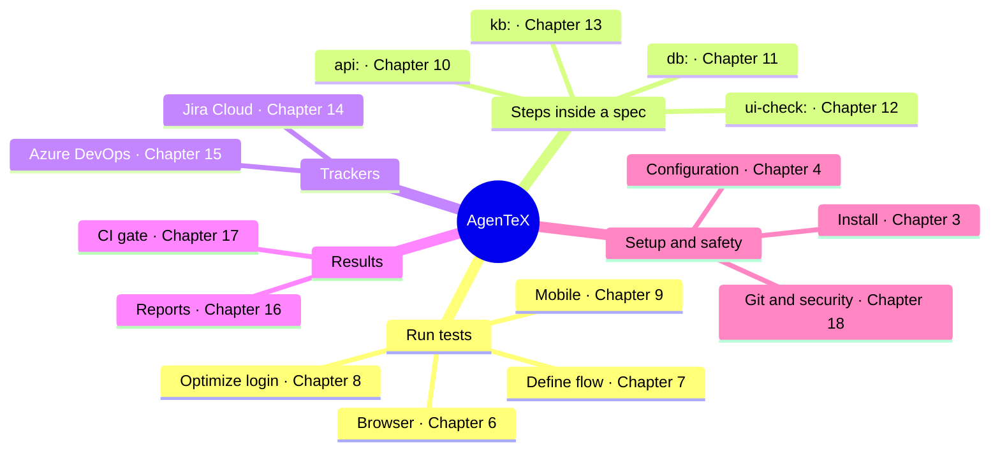

# 1. What is AgenTeX?

[Contents](./README.md) · Next: [2. Quick start by goal →](./02-quick-start-by-goal.md)

AgenTeX (**Agen**tic **Te**st e**X**ecution) is a QA plugin for Claude Code. You say what to test,
in plain English or in a short spec file. An agent then plans the scenarios, drives a **real
browser** (Playwright CLI) or a **real mobile app** (Appium), calls your APIs and database,
saves screenshots and logs as evidence, and writes a full defect report.

To see which AgenTeX version you have, run `/plugin` in Claude Code or open
`.agentex/version.json` in your project. After a plugin update, check
[CHANGELOG.md](../../../CHANGELOG.md) for anything new.

## 1.1 What it does for a tester

| Area | What AgenTeX does |
|------|-------------------|
| **Web / browser testing** | Runs your scenarios in a real Chromium browser. Checks what is visible on the page, console errors and failed network calls. |
| **Mobile testing** | Runs the same kind of flow on native Android / iOS apps through Appium, and watches the device log for crashes. |
| **API testing** | Runs `api:` steps inside specs, or a full standalone API pass with `/test-endpoints`. Can generate the tests from Swagger / OpenAPI. |
| **Database checks** | Runs `db:` steps: only the named SQL queries you defined, never its own SQL. DDL (`DROP`, `TRUNCATE`, `ALTER`) is always refused. |
| **Design checks** | `ui-check:` steps compare the live page with a Figma frame or a baseline screenshot. |
| **Jira / Azure DevOps** | Estimates QA effort and creates `[Testing]` tasks, designs test cases from acceptance criteria, files bugs with screenshots. Always behind **one** approval screen. |
| **Reports** | Every run writes `report.md`, an interactive `extent-report.html` dashboard, screenshots, logs and a merged bug list. |
| **CI/CD** | A headless quality gate for GitHub Actions or Azure Pipelines with clear exit codes: `0` PASS, `1` FAIL, `2` BLOCKED. |

## 1.2 Safety guarantees, and what enforces each one

### Where AgenTeX writes files

| Activity | Writes to |
|----------|-----------|
| Test runs (`/execute-test`, mobile, API pass) | `executions/` only, plus `test/.auth/` when it saves a login session |
| `/define-flow` | New spec files under `test/` |
| `/init-test`, `/update-agentex` | `config/`, `environments/`, `integration/`, `test/`, `.env`, `.agentex/`, `.gitignore`, `CLAUDE.md` |
| `/import-swagger`, the suite editor | `integration/`, `.agentex/cache/`, `test/.auth/api-tokens/` |
| Estimation, test design | `config/estimation.json`, `.agentex/`, and your tracker (after your approval) |
| **Your application source** | **Never**, by design. Only the `Edit(...)` deny rule enforces it (see below). |

### Three kinds of enforcement

Not every guarantee is enforced the same way. Know which kind each one is:

- **Code:** checked by a bundled script. It holds even if the agent makes a mistake.
- **Your permissions:** holds only after you copy the permission rules ([3.5](./03-installation.md#35-set-permissions-important)).
- **Agent rules:** instructions the agent follows. Strong defaults, not hard walls.

Every action passes through all three layers, outermost first:

| Guarantee | Enforced by | What you must do |
|-----------|-------------|------------------|
| `db:` steps run only cataloged queries; DDL refused; parameters sanitized | **Code** (`run_db.js`) | Nothing. A bare `sqlcmd` outside the runner still asks you first. |
| `api:` steps run only cataloged requests | **Code** (`run_api.js`) | Nothing. A bare `curl` asks you first. |
| Tracker writes (Jira / Azure) only after one approval; none at all in CI | **Code** (bundled scripts; `AGENTEX_CI=1` refuses writes) | Read the approval screen before approving. |
| Mobile app data is not reset without consent | **Code** (`appium_client.js`) + agent rules for raw REST calls | Approve a reset only when you want one. |
| Claude cannot read `.env`, keys or saved sessions | **Your permissions** (deny rules) | Copy the `deny` block into `.claude/settings.json`. Without it, this is not enforced. |
| Your application source is never edited | **Your permissions** (`Edit(./src/**)`) + agent rules | Point the rule at your real source folder. If your code is not in `./src`, the default rule protects nothing. |
| Secret values are never printed or put on a command line | **Code** for the bundled scripts (`fill_secret.js`, `--text-env`, header-only tokens) + **agent rules** for page text, console logs, request bodies and traces | Declare secrets as `envSecret`. Review screenshots before sharing them; they are not scanned. |
| No captcha / OTP bypass. In UI runs, no account creation, payments or real personal data | **Agent rules** | Use test environments and disposable test users. |

> **Not guaranteed: these really run.** Cataloged `api:` writes (POST / PUT / DELETE: the
> catalog *is* the authorization), and every step you approve in `/define-flow`, including
> add / edit / delete. **No code check blocks production.** A DELETE or payment endpoint in the
> catalog runs against whatever `baseUrl` the environment points to. Keep AgenTeX on
> non-production environments.

## 1.3 The two run modes

| Mode | How to start it | What happens |
|------|-----------------|--------------|
| **Sequential** (default) | `/execute-test <url>` or a plain-English request | Human in the loop. Claude proposes scenarios, waits for your OK, runs one at a time and pauses after each. Best for exploratory and first runs. |
| **Parallel** (autonomous) | "Run a **parallel** regression … from the specs in `test/suite1/`" | One isolated subagent and browser session **per spec file**, no pauses. Results are merged into one report. Best for regression suites. |

A **subagent** is a separate Claude worker with its own session.

## 1.4 All commands at a glance

| Command | What it does | Chapter |
|---------|--------------|---------|
| `/init-test` | Sets up AgenTeX in your project: sample specs, config, environment, `.env`, tracker choice. | [3](./03-installation.md) |
| `/execute-test <url \| suite>` | Runs browser / API / DB specs. | [6](./06-browser-testing.md) |
| `/define-flow <url \| spec>` | Builds a spec live, step by step, while it executes. | [7](./07-define-flow.md) |
| `/execute-mobile-test <suite>` | Runs native Android / iOS specs through Appium. | [9](./09-mobile-testing.md) |
| `/test-endpoints [--edit]` | Runs every cataloged API test case; `--edit` opens the suite editor. | [10](./10-api-testing.md) |
| `/import-swagger <file\|url> [--wizard]` | Generates the API catalog and test suite from Swagger / OpenAPI JSON. | [10](./10-api-testing.md#105-generate-tests-from-swagger--openapi) |
| `/ask-kb <question>` | Asks your project knowledge base (advisory only). | [13](./13-knowledge-base.md) |
| `/estimate-story <ids>` | Estimates QA effort for named stories and creates `[Testing]` tasks. | [14](./14-jira-cloud.md), [15](./15-azure-devops.md) |
| `/estimate-sprint` | The same for every story in the current sprint. | [14](./14-jira-cloud.md), [15](./15-azure-devops.md) |
| `/design-test <ids>` | Turns story acceptance criteria into linked test cases. | [14](./14-jira-cloud.md), [15](./15-azure-devops.md) |
| `/update-agentex` | After a plugin update: migrates your project to the new conventions, keeping your values. | [19](./19-keeping-up-to-date.md) |

Slash commands are optional. You can always describe what you want in plain English, for
example: *"Test https://example.com — the signup form: happy path plus empty and bad-email
cases."* Claude picks the right skill by itself.

## 1.5 How it fits together

You type a command or a request. Claude picks the matching **skill** (a packaged ability),
which sends each step to a **driver** (the part that executes it: browser, mobile, API, DB, UI
check, knowledge base, tracker). In parallel runs, the work goes to subagents. Every result
lands in `executions/`.

In parallel mode, Claude starts one subagent per spec file (`qa-executor`,
`mobile-qa-executor`, `api-executor`), each with its own session, and merges their results.

### Everything AgenTeX covers, at a glance

## 1.6 When to use AgenTeX

- Manual regression you repeat every sprint ([6.3](./06-browser-testing.md#63-parallel-regression-autonomous), [9.4](./09-mobile-testing.md#94-step-4--run-it)).
- Exploratory first runs where you want to watch and steer ([6.1](./06-browser-testing.md#61-sequential-run-human-in-the-loop)).
- Flows that cross UI, API and database ([10.2](./10-api-testing.md#102-step-2--use-api-steps-in-a-spec), [11.3](./11-database-checks.md#113-step-3--use-it-in-a-spec)).
- Turning acceptance criteria into test cases and estimates ([14](./14-jira-cloud.md), [15](./15-azure-devops.md)).
- Writing a reliable spec by doing it ([7](./07-define-flow.md)).
- A quality gate in your pipeline ([17](./17-ci-quality-gate.md)).
