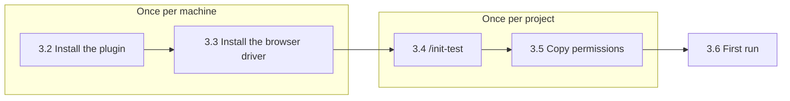
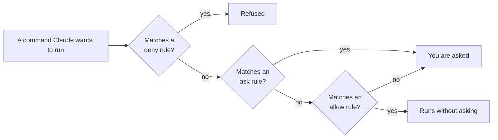
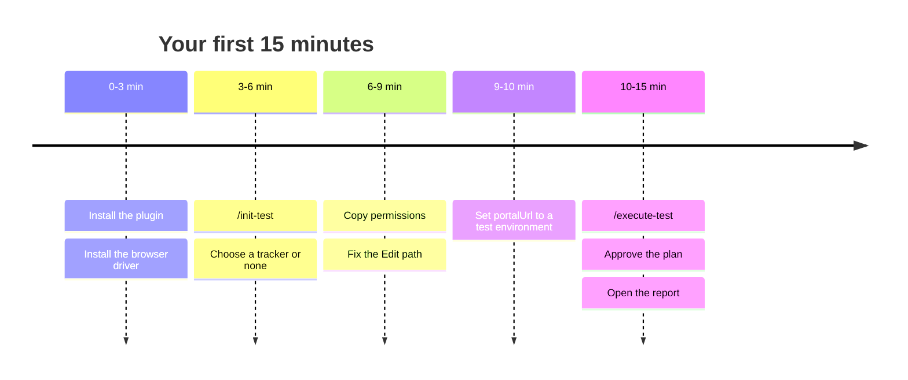

# 3. Installation and first setup

← [2. Quick start by goal](./02-quick-start-by-goal.md) · [Contents](./README.md) · Next: [4. Configuration →](./04-configuration.md)

Do steps 3.2–3.3 once per machine and steps 3.4–3.5 once per project. It takes about 10
minutes.



## 3.1 Prerequisites

| What | Why / when |
|------|------------|
| **Claude Code** | AgenTeX is a Claude Code plugin. New to it? See [3.7](#37-new-to-claude-code-the-basics). |
| **Node.js 20+** and npm | Every bundled script is a Node script. Always needed. |
| **@playwright/cli** | Only for browser specs. Installed in [3.3](#33-install-the-browser-driver). |
| **Appium + a driver** | Only for mobile testing ([9.1](./09-mobile-testing.md#91-step-1--install-appium-and-a-driver)). |
| **sqlcmd** | Only for `db:` steps on SQL Server ([11.2](./11-database-checks.md#112-step-2--install-sqlcmd)). |
| **az CLI** | Only to read Azure resources during a run. Not needed for Azure DevOps boards. |

## 3.2 Install the plugin

1. **Open Claude Code** in the folder of the project you want to test.
2. **Add the marketplace and install AgenTeX:**

   ```
   /plugin marketplace add MhmdElGazzar/elgazzar-plugins
   /plugin install agentex@elgazzar-plugins
   ```

3. **Restart or reload Claude Code** if it asks, then type `/`. You should see `/init-test`,
   `/execute-test` and the other commands.

## 3.3 Install the browser driver

In your project folder (Claude also offers to do this for you):

```
npm install -D @playwright/cli
npx playwright-cli install-browser chromium
```

> **Only testing APIs?** Specs with no browser steps need no browser. They declare
> `Drivers: api`, `Drivers: db` or `Drivers: api, db` in their header, and you can skip this step.

## 3.4 Scaffold the project with `/init-test`

1. Run `/init-test`.
2. **Answer the wizard.** It asks which work tracker you use: **Azure DevOps**, **Jira Cloud**
   or **none**. Only that tracker gets configured.
3. **Review what was created:**

```
your-project/
├── config/project.json        # project settings (tracker, login mode, KB, Figma)
├── environments/qc.json       # target URL, test users, db / api blocks
├── .env                       # SECRETS ONLY — gitignored
├── integration/               # API + DB catalog (the only calls tests may make)
│   ├── sample_api.json
│   └── sample_db.json
├── test/
│   └── suite1/                # sample specs — edit them for your app
│       ├── product-search.md
│       └── signup-form.md
├── executions/                # run results land here
├── .agentex/version.json      # plugin version this project matches
└── CLAUDE.md                  # project guidance for Claude
```

The wizard can also install an optional **pre-commit hook** that scans for secrets before each
commit (see [18.3](./18-git-and-security.md#183-secret-scan-and-pre-commit-hook)).

## 3.5 Set permissions (important)

A plugin cannot ship permission rules, so you copy them yourself. Without this step, Claude
stops to ask before every single browser command.

1. **Open** [`settings.example.json`](../../../settings.example.json) from the AgenTeX repository.
2. **Copy** its `"permissions"` block into your project's `.claude/settings.json`. Merge it with
   anything already there.
3. **Fix two entries** for your project:
   - `Edit(./src/**)` protects your app's source only if it really lives in `./src`. Point it
     at your real source folder.
   - **Recommended:** replace `Bash(node:*)` with `Bash(node <installed plugin path>/skills:*)`,
     which allows only AgenTeX's own scripts. Run `/plugin` to see the path. Keep the broad
     `Bash(node:*)` only on a personal sandbox: it allows *any* node command.

A shortened view of what the block does:

```json
"permissions": {
  "allow": [ "Bash(npx playwright-cli:*)", "Bash(node:*)", "Bash(adb devices:*)",
             "Bash(npx appium server:*)", "Bash(az account:*)", ... ],
  "ask":   [ "Bash(curl:*)", "Bash(sqlcmd:*)", "Bash(adb uninstall:*)",
             "Bash(npx appium driver install:*)", ... ],
  "deny":  [ "Read(./.env)", "Read(./**/*.pem)", "Read(./test/.auth/**)",
             "Edit(./src/**)", "Bash(rm -rf:*)", "Bash(git push:*)", ... ]
}
```

> **How rules are checked:** **deny** first, then **ask**, then **allow**. So an `ask` entry can
> carve a prompt out of a broader `allow`. For example, `close-all` still asks you even though
> `npx playwright-cli:*` is allowed.



## 3.6 Your first 15 minutes

| Minute | Do |
|--------|----|
| 0–3 | Install the plugin ([3.2](#32-install-the-plugin)) and the browser driver ([3.3](#33-install-the-browser-driver)). |
| 3–6 | Run `/init-test` and choose your tracker or "none" ([3.4](#34-scaffold-the-project-with-init-test)). |
| 6–9 | Copy the permissions block ([3.5](#35-set-permissions-important)) and fix the `Edit(...)` path. |
| 9–10 | Set `portalUrl` in `environments/qc.json` to a **test** environment of your app. |
| 10–15 | Run the steps below and open the report. |



1. **Edit the target.** Open `environments/qc.json` and set `"portalUrl"` to your app, or edit
   `Target:` in `test/suite1/signup-form.md`.
2. **Run** `/execute-test https://your-app.com`.
3. **Approve the plan.** Claude restates what it will test and lists numbered scenarios.
   Nothing runs until you approve.
4. **Watch and confirm.** After each scenario Claude reports PASS / FAIL with a screenshot and
   pauses.
5. **Open the results** in `executions/execu_<timestamp>/`: `report.md`, `extent-report.html`
   and `bugs/bug-list.md`.

## 3.7 New to Claude Code? The basics

- **Type a request** in plain English, the way you would ask a colleague.
- **Slash commands** (`/execute-test …`) are shortcuts that run one exact ability.
- **Approving actions:** Claude pauses before running a new command or before an AgenTeX action
  such as filing a bug. Nothing happens until you respond. This is a safety feature.
- **AgenTeX checkpoints** come on top of that: a sequential run stops after planning and after
  every scenario.

More in [docs/using-claude-code.md](../../using-claude-code.md).

## 3.8 Running bundled scripts yourself: the plugin path

Some chapters show commands such as `node ${CLAUDE_PLUGIN_ROOT}/skills/…`.
`${CLAUDE_PLUGIN_ROOT}` exists **only inside Claude Code**. In your own terminal it is empty,
and the command fails. This guide writes the path as `<plugin-root>`.

- **Easiest:** ask Claude to run it, for example *"check my saved session for qc / valid_user"*.
- **By hand:** run `/plugin` in Claude Code to see the installed path, and use it in place of
  `<plugin-root>`.
- **In CI:** use a pinned checkout of the AgenTeX repository as `<plugin-root>`. Never hardcode
  `~/.claude/plugins/…`; that cache changes across updates.

> **Other AI tools:** AgenTeX is also published for **OpenAI Codex**, **GitHub Copilot** and
> **Devin**, each on its own branch of the repository (see [hosts/](../../../hosts/README.md)).
> This guide uses Claude Code.
