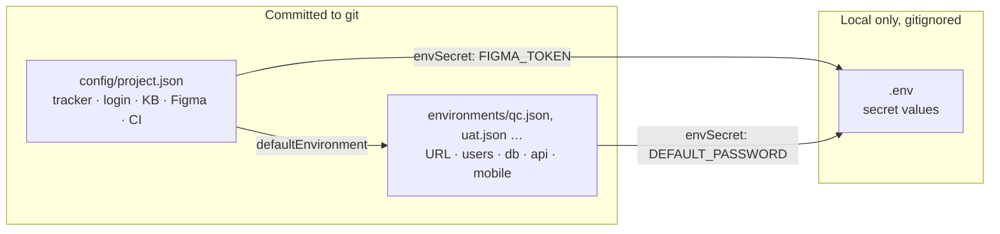
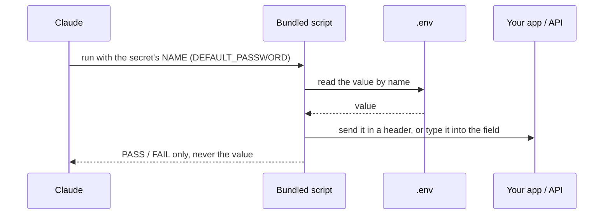
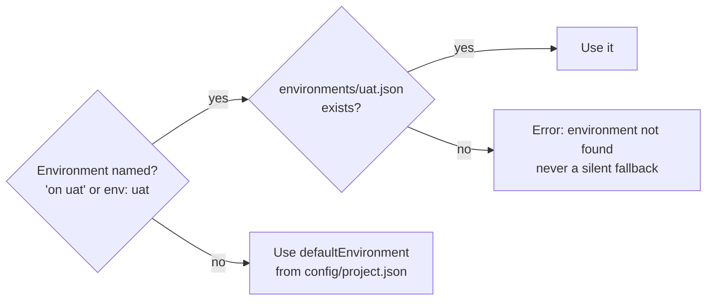
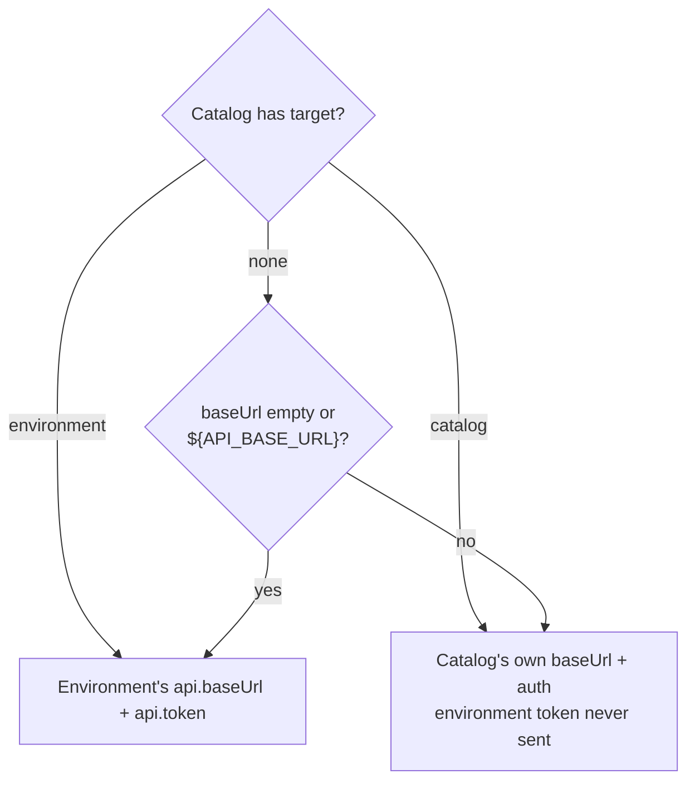

# 4. Configuration

← [3. Installation](./03-installation.md) · [Contents](./README.md) · Next: [5. Writing test specs →](./05-writing-test-specs.md)

Every kind of project data has exactly one home. Learn these three files and you know the
whole setup.

| Kind | Examples | Home |
|------|----------|------|
| Secrets | PAT, API tokens, passwords | `.env` (and only these) |
| Project settings | Tracker, login mode, knowledge base, Figma, CI policy | `config/project.json` |
| Environment data | Portal URL, database, API, test users, default OTP | `environments/<env>.json` |

The full key-by-key reference is [docs/configuration.md](../../configuration.md).



## 4.1 The golden rule: `envSecret`

JSON files never hold a real secret. A secret field points to a variable in `.env` **by name**:

```jsonc
"password": { "envSecret": "DEFAULT_PASSWORD" }   // in environments/qc.json
```

```
DEFAULT_PASSWORD=MyQaPass123                      # in .env
```

A plain string is accepted only for shared, throw-away test credentials, and the secret scan
warns about it.

How a secret travels, without Claude ever seeing it:



## 4.2 `config/project.json`

The template the wizard creates (shortened):

```json
{
  "name": "my-project",
  "defaultEnvironment": "qc",
  "kb":    { "baseUrl": "", "project": "" },
  "figma": { "fileKey": "", "token": { "envSecret": "FIGMA_TOKEN" } },
  "login": { "mode": "session" }
}
```

| Key | Purpose |
|-----|---------|
| `defaultEnvironment` | The environment used when a run doesn't name one. |
| `azure` **or** `jira` | Tracker settings. A project has **one** tracker block, never both ([14.1](./14-jira-cloud.md#141-one-time-setup), [15.1](./15-azure-devops.md#151-one-time-setup)). |
| `login.mode` | `"session"` reuses a saved login; `"fresh"` logs in through the UI on every run ([Ch. 8](./08-optimize-login.md)). |
| `kb` | Knowledge-base settings ([Ch. 13](./13-knowledge-base.md)). |
| `figma`, `viewports` | Design source and viewport sizes for `ui-check:` ([Ch. 12](./12-ui-check.md)). |
| `ci` | Optional CI gate policy ([Ch. 17](./17-ci-quality-gate.md)). |

## 4.3 `environments/<env>.json`

One file per environment: `qc.json`, `uat.json`, `live.json` … The sample `/init-test` creates:

```json
{
  "portalUrl": "https://example.com",
  "defaults": {
    "otp": "0000",
    "password": { "envSecret": "DEFAULT_PASSWORD" }
  },
  "users": {
    "valid_user":   { "phone": "0550000001", "role": "customer" },
    "expired_user": { "phone": "0550000002", "notes": "for negative login scenarios" }
  },
  "db": {
    "server": "localhost", "port": 1433, "name": "my-database",
    "user": "qa_user", "password": { "envSecret": "SQLCMDPASSWORD" }
  },
  "api": {
    "baseUrl": "https://jsonplaceholder.typicode.com",
    "token": { "envSecret": "API_TOKEN" }
  }
}
```

| Key | Purpose |
|-----|---------|
| `portalUrl` | The app under test. Required for browser specs. |
| `defaults` | Static test values: `otp`, `captcha`, a shared `password`. |
| `users` | Test accounts by handle. A spec says "log in as `expired_user`". A user without a password uses `defaults.password`. |
| `users.<name>.disabled` | A reason string, for example `"account locked"`. The suite wizard never signs in as that user. |
| `db` / `api` | Connections for `db:` / `api:` steps. |
| `mobile` | The Appium target (opt-in, [9.2](./09-mobile-testing.md#92-step-2--add-a-mobile-block-to-your-environment)). |
| `nonProduction: true` | Lets the suite wizard create missing test data through the UI, after your consent. |

### Choosing the environment at run time

Say *"run on uat"*, or put `env: uat` in a spec. AgenTeX then reads `environments/uat.json`.
Without that, it uses `defaultEnvironment`. Naming an environment that has no file is an error,
never a silent fallback.



### Which base URL and token does an `api:` step use?

| Catalog setting | Base URL and auth come from |
|-----------------|-----------------------------|
| `"target": "environment"` | Always the active environment's `api.baseUrl` and `api.token`. |
| `"target": "catalog"` (every Swagger import) | The catalog's own `baseUrl` and `auth`; the environment's token is never sent. |
| No `target`, and `baseUrl` empty or `"${API_BASE_URL}"` | The environment (like the sample catalog). |
| No `target`, any other `baseUrl` | The catalog's own `baseUrl` and `auth`. |



For a token, the variable named by the catalog's `tokenEnv` in your shell or `.env` always wins
over a token the suite wizard captured. The legacy `API_BASE_URL` / `API_TOKEN` in `.env` are a
fallback when the environment has no `api` block.

### Adding a second environment (for example UAT)

1. **Copy** `environments/qc.json` to `environments/uat.json`.
2. **Change** `portalUrl`, the users and the `db` / `api` blocks for UAT.
3. **Use different secret names** if the values differ, for example
   `{ "envSecret": "SQLCMDPASSWORD_UAT" }`, and add `SQLCMDPASSWORD_UAT=` to `.env`.
4. **Run** `/execute-test suite1 on uat`.

## 4.4 `.env`: secrets only

```
# Azure DevOps
AZURE_PAT=
# Jira Cloud
JIRA_EMAIL=
JIRA_API_TOKEN=
# Database (read natively by sqlcmd)
SQLCMDPASSWORD=
# API bearer token for api: steps
API_TOKEN=
# Others
KB_ASK_API_KEY=
FIGMA_TOKEN=
DEFAULT_PASSWORD=
```

Fill in only what you use. Any variable named in an `{ "envSecret": "…" }` field belongs here
too, for example `SQLCMDPASSWORD_UAT`.

> **Never commit `.env`.** `/init-test` adds it to `.gitignore`. With the permission rules from
> [3.5](./03-installation.md#35-set-permissions-important), Claude is denied reading it; the
> bundled scripts read it themselves and send values only in request headers.
