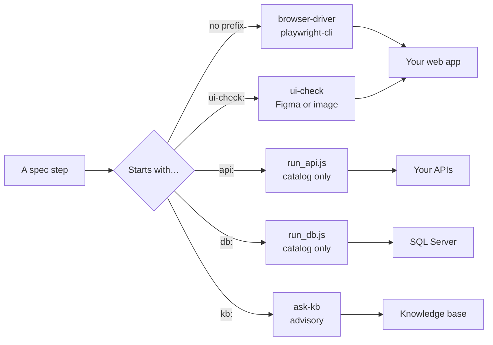
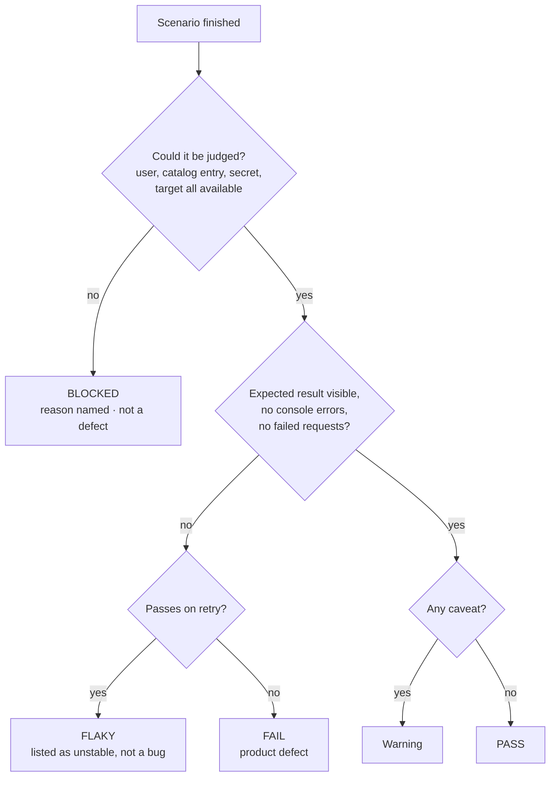

# 5. Writing test specs

← [4. Configuration](./04-configuration.md) · [Contents](./README.md) · Next: [6. Browser testing →](./06-browser-testing.md)

A **spec** is a plain markdown file: a target, what "correct" means, and numbered scenarios in
plain language. No code.

## 5.1 Anatomy of a spec

The sample `test/suite1/signup-form.md` that `/init-test` creates:

```markdown
# Spec: Signup form validation

Target: https://example.com/signup
Type: form validation — NO real account is created (validation-only)

## Acceptance criteria
- Valid input reaches a visible success/confirmation state.
- Invalid input is rejected with a specific, visible error message; the form must not submit.
- No console errors or failed network calls during any scenario.

## Scenarios
1. **Happy path** — fill Name, a disposable email (`qa.tester@example.com`), and a valid
   password, then submit. Expect a visible success confirmation.
2. **Empty required fields** — submit with every field blank. Expect an inline
   "required" error on each field; the form must not submit.
3. **Bad email format** — enter `not-an-email` and submit. Expect an email-format error.
4. **Weak password** — enter a 3-character password and submit. Expect a strength error.

## Notes
- Screenshot every scenario (pass and fail).
- Treat any console error or failed request as a defect even if the UI looks fine.
```

| Part | What to write |
|------|---------------|
| `Target:` | The URL or page under test. |
| `Type:` | A short description, and whether real data is created. |
| `Drivers:` | Optional: `api`, `db`, `mobile`. Without it, the spec is a browser spec. |
| Acceptance criteria | What "pass" means. Include "no console errors / failed calls". |
| Scenarios | Numbered: happy path, edge cases, negative cases. |
| Notes | Order that matters, disposable data, special rules. |

## 5.2 Step types you can mix in one spec

A step's prefix decides which **driver** (the part of AgenTeX that executes it) handles it.

| Step in a spec | Handled by | Example |
|----------------|------------|---------|
| Plain prose | browser-driver | `Click "Search" and expect results` |
| `api: …` | api-integration | `api: sample-api.get-todo(id=1) → expect HTTP 200` |
| `db: …` | db-integration | `db: sample-db.todo-by-title(title=x) → expect 1 row` |
| `kb: …` | ask-kb (advisory) | `kb: how is the discount applied?` |
| `ui-check: …` | ui-check (needs a browser) | `ui-check: figma 123:456 — mode: exact` |



Chapters: [6 browser](./06-browser-testing.md) · [10 API](./10-api-testing.md) ·
[11 database](./11-database-checks.md) · [12 UI check](./12-ui-check.md) ·
[13 knowledge base](./13-knowledge-base.md).

## 5.3 Stateful chains: keep dependent steps in one file

**One spec file = one browser session.** If steps depend on each other (log in → act → check),
keep them in the same file and mark them stateful. The sample `test/suite1/product-search.md`:

```markdown
# Spec: Product search
Target: https://example.com
Type: search / results — read-only, stateful chain

## Scenarios  (stateful — run in order, in one session)
1. Search a common term (e.g. `shirt`); expect at least one result rendered.
2. Search a nonsense term (e.g. `zzzxqq`); expect a visible "no results" message.
3. Clear the search box; expect the default/full listing to return.
```

## 5.4 Organizing specs into suites

- A **suite** is just a folder: `test/suite1/`, `test/suite2/`, `test/mobile-suite1/`.
- Keep each file to **one independent feature or flow**. In parallel mode each file gets its
  own session.
- Run one suite: `/execute-test suite2` runs only `./test/suite2/`.
- Users: write "log in as `valid_user`". The user must exist in the active environment's
  `users`, or the step is BLOCKED (never improvised).

> **Don't want to write specs by hand?** Use [/define-flow](./07-define-flow.md). Claude builds
> the spec while running it live, and you confirm each step.

## 5.5 Result statuses you will see

| Status | Meaning |
|--------|---------|
| **PASS** | The expected result was seen, checked by real visibility on the page, not just by the element existing in the HTML. |
| **FAIL** | A product defect: wrong behavior, a console error or a failed network call. |
| **BLOCKED** | Could not be judged: a missing user, catalog entry or secret, an unreachable target, a captcha… The reason is always named. Not a product defect. |
| **Warning** | Passed with a caveat, for example layout drift in a `ui-check` reference mode. |
| **View mismatch** | A `ui-check` baseline is for a different form factor than the run (for example a mobile design against a desktop run). |

How a scenario gets its status:



More on specs: [docs/test-execution.md](../../test-execution.md).
