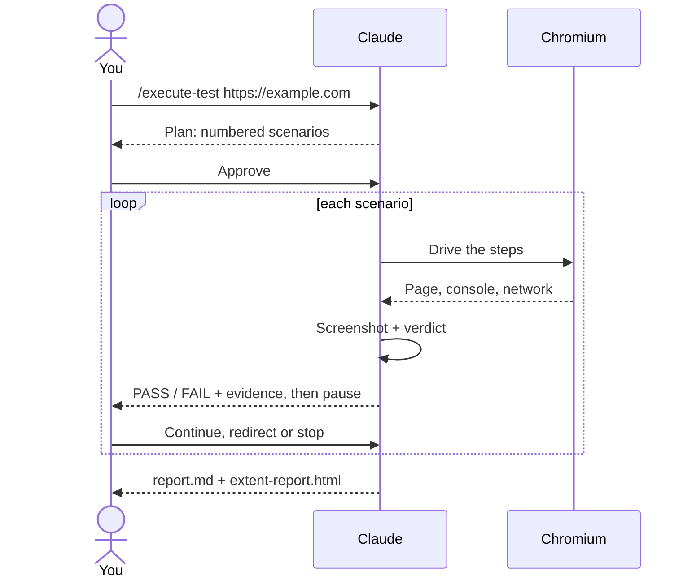
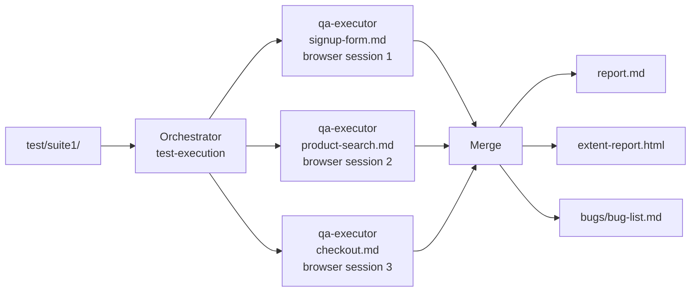

# 6. Browser testing

← [5. Writing test specs](./05-writing-test-specs.md) · [Contents](./README.md) · Next: [7. Define flow →](./07-define-flow.md)

The core of AgenTeX: you describe what to test, and Claude drives a real browser, captures
evidence, checks for errors and reports.

## 6.1 Sequential run (human-in-the-loop)

1. **Start the run** with a command or plain English:

   ```
   /execute-test https://example.com

   # or
   Test https://example.com — the signup form: happy path plus empty and bad-email cases.
   ```

2. **Plan.** Claude restates what it understood and lists numbered scenarios (happy, edge,
   negative). **Nothing runs yet.** Approve, edit or remove scenarios.
3. **Drive.** A real Chromium browser opens. Each scenario runs one at a time with a screenshot
   (pass or fail), while console errors and failed network calls are watched.
4. **Checkpoint.** After each scenario you see PASS / FAIL with evidence. Claude pauses so you
   can stop or redirect.
5. **Report.** Everything is written to `executions/execu_<timestamp>/`.



## 6.2 Run a suite folder

```
/execute-test suite1                   # runs ./test/suite1/
/execute-test test/suite3/ on uat      # a suite against environments/uat.json
/execute-test https://example.com      # a target URL; scenarios are planned with you
```

A suite folder that doesn't exist yet is created and seeded with a starter spec for you to
adapt. With no suite named, `./test/suite1/` is used.

## 6.3 Parallel regression (autonomous)

1. **Ask explicitly for "parallel":**

   ```
   Run a parallel regression against https://example.com from the specs in test/suite1/.
   ```

2. **Claude starts** one `qa-executor` subagent, each with its own browser session, per spec
   file. There are no approval pauses.
3. **Results merge** into one `report.md`, one dashboard and one merged `bug-list.md`.



> **Isolation:** every run gets uniquely named browser sessions, never Playwright's shared
> `default` one. Two runs, even in two Claude Code windows, never share a browser, and each run
> closes only the browsers it opened.

## 6.4 What you get

```
executions/execu_2026-11-10_14-02-11/
├── report.md                      # summary: what passed, what failed
├── extent-report.html             # interactive dashboard
├── browser-sessions/<session>/
│   ├── logs/                      # console / network captures, api/db evidence
│   └── screenshots/               # one per scenario
└── bugs/
    ├── bug-list.md                # merged defect list
    └── screenshots/
```

Chapter [16](./16-reports-and-evidence.md) explains each file.

## 6.5 Tips for good browser runs

- Write **expected results** that are visible: "a visible success message", not "the request
  succeeds".
- Use **disposable data** (`qa.tester@example.com`). AgenTeX never creates real accounts or
  completes payments.
- A **captcha or OTP** is never bypassed. A fixed test OTP in `defaults.otp` is typed; anything
  else waits for you.
- Logging in on every scenario is slow. Turn on [Optimize login](./08-optimize-login.md).

More: [docs/test-execution.md](../../test-execution.md).
