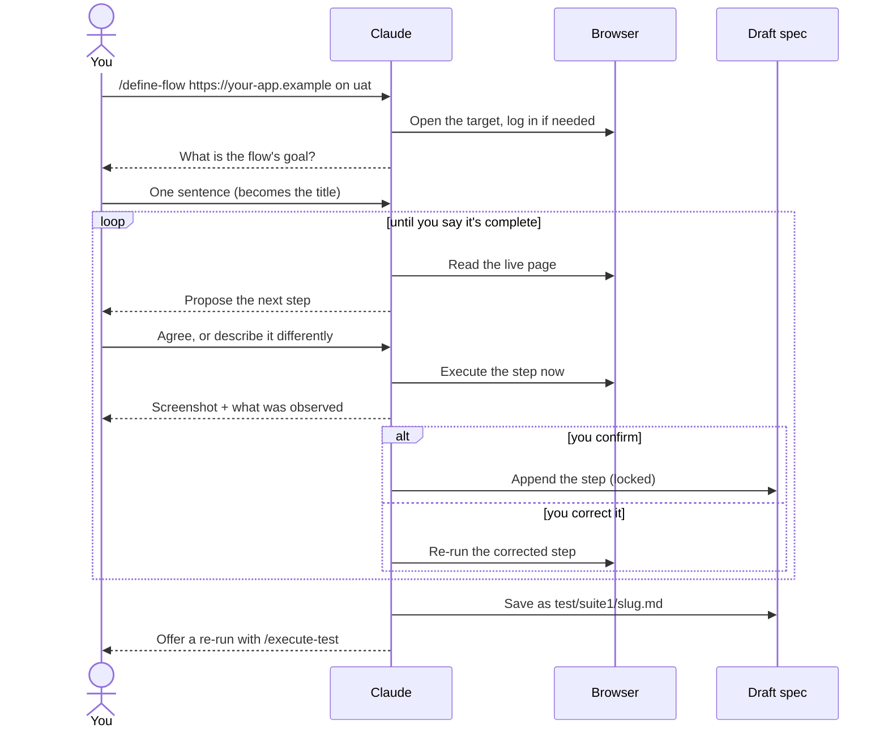

# 7. Define flow: build a spec by doing it

← [6. Browser testing](./06-browser-testing.md) · [Contents](./README.md) · Next: [8. Optimize login →](./08-optimize-login.md)

Instead of writing 15 steps from memory and finding out later that step 7 was wrong,
`/define-flow` builds the spec **live**. Each step is proposed, executed in the browser and
confirmed by you before the next one.

## 7.1 Defining a new flow

1. **Start:** `/define-flow https://your-app.example on uat`
2. **Setup.** Claude resolves the target and environment, logs in if needed, and asks for the
   flow's goal in one sentence. That sentence becomes the spec title.
3. **One step at a time.** Claude looks at the live page and proposes the next step, for
   example *"I can see a Submit order button — is submitting next?"*, or offers the visible
   options as choices.
4. **You check the result.** The step runs immediately; you see a screenshot and what was
   observed. Confirm it, or correct it and Claude runs it again. Corrections go **forward
   only**: earlier confirmed steps are locked.
5. **Values carry forward.** When a step produces something (for example an order number),
   Claude offers "use this later?". It is saved by description, not by value: *"the order number
   produced in step 3"*. Unique inputs become *"a fresh disposable email"*, so re-runs still pass.
6. **Save.** Say the flow is complete. Claude saves a normal spec, by default as
   `test/suite1/<slug>.md`.
7. **Prove it twice (optional).** Claude offers to re-run the new spec with `/execute-test`.



> **Nothing is lost.** Every confirmed step is added to a running draft immediately. A crash at
> step 14 keeps steps 1–13. If you must stop early, you can save a partial spec, clearly marked
> incomplete.

## 7.2 Clarifying an existing spec

```
/define-flow test/suite1/checkout.md
```

Claude walks the spec live, step by step. Any unclear step (an ambiguous target, a missing
expected result) becomes a question to you. The result is saved as a **new** spec file. Your
original only gets one note at the top: "Defined flow available at `<path>`".

> **Use a test environment.** You direct every step, so Claude executes what you approve,
> including add / edit / delete actions. Run define sessions only on an environment you are
> responsible for.

More: [docs/define-flow.md](../../define-flow.md).
