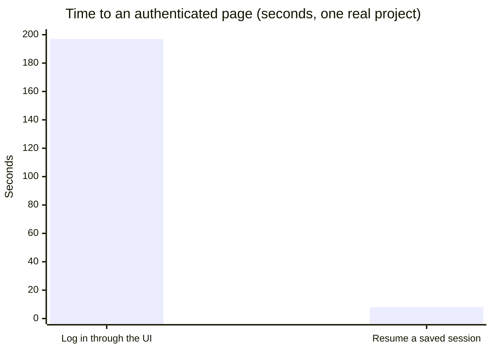
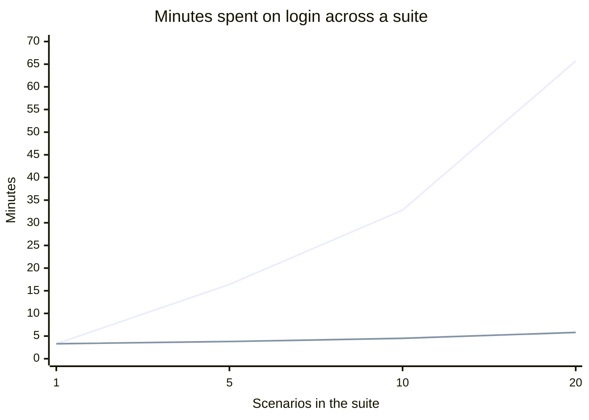
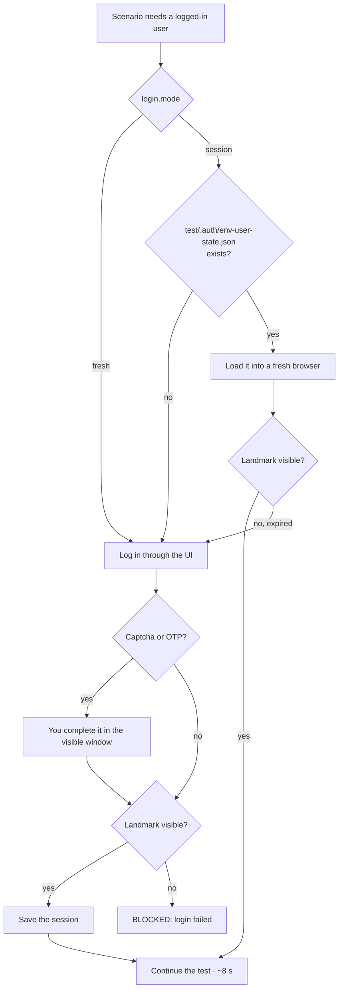

# 8. Optimize login: log in once, reuse it

← [7. Define flow](./07-define-flow.md) · [Contents](./README.md) · Next: [9. Mobile testing →](./09-mobile-testing.md)

Login is usually the slowest part of a web test. In session mode, Claude pays for it once:
about **8 seconds** to resume instead of about **197 seconds** to log in, measured on a real
project.



Over a suite the difference adds up: 10 scenarios that each log in spend about 33 minutes on
login; with one login and 9 resumes it is about 4.5 minutes.



The upper line is `"fresh"` (log in every scenario); the lower line is `"session"` (log in
once, then resume). Calculated from the two measured times above.

## 8.1 Turn it on

1. **Set the mode** in `config/project.json`:

   ```jsonc
   "login": { "mode": "session" }   // "fresh" = log in through the UI on every run
   ```

2. **Run a test as usual.** The first run logs in for real and confirms it by a **landmark**: an
   element only a logged-in page shows (never by the URL). The session is saved to
   `test/.auth/<env>-<user>-state.json`.
3. **Later runs** load that session into a fresh browser and check it is still valid. If it has
   expired, Claude logs in again and saves a new one.



## 8.2 Captcha and OTP

Claude never bypasses them. It runs with a visible browser window and waits for you to complete
that one step. The session is then saved, so you only do it once.

## 8.3 Check a saved session manually

```
node "<plugin-root>/skills/optimize-login/scripts/session.js" resume \
  --state test/.auth/qc-valid_user-state.json \
  --url   https://app.example.com/dashboard \
  --absent "role=button[name='Login']"
```

`<plugin-root>` is explained in [3.8](./03-installation.md#38-running-bundled-scripts-yourself-the-plugin-path).
This needs `npm i -D playwright` and `npx playwright install chromium` in your project. Use
`--present "<selector>"` instead of `--absent` to check for an element that only appears when
logged in. Add `--headed` to watch it, or `--channel chrome` to use real Chrome.

| Situation | What happens |
|-----------|--------------|
| Login kept in cookies / localStorage | Saved and resumed normally. |
| Login kept in IndexedDB | Cannot be resumed; the check after loading fails plainly. Use `"fresh"`. |
| One file per environment + user | `qc-valid_user` and `uat-valid_user` are separate sessions. |
| CI | Never saves a login; it may load one the pipeline provides. |
| A session file from an older version (named per app) | Ignored; the first run logs in once and saves it under the new name. |

> **A session file is a password.** `test/.auth/` is gitignored. Never commit or publish it.

More: [docs/optimize-login.md](../../optimize-login.md).
