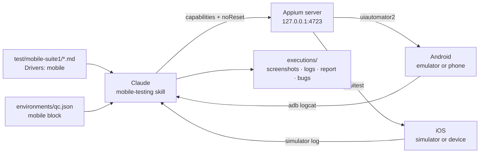
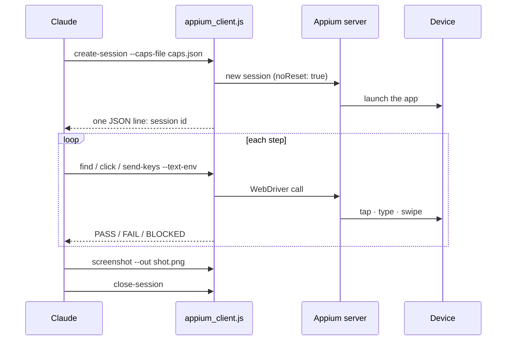

# 9. Mobile testing (Android / iOS)

← [8. Optimize login](./08-optimize-login.md) · [Contents](./README.md) · Next: [10. API testing →](./10-api-testing.md)

The same flow as browser testing, for native apps. Claude drives a real Appium session, takes
screenshots, watches the device log (`adb logcat` or the simulator log) for crashes, and
reports.

Want the short version? See the [Mobile Testing User Guide](../mobile/README.md).



## 9.1 Step 1 — Install Appium and a driver

```
npm install -D appium
npx appium driver install uiautomator2    # Android
npx appium driver install xcuitest        # iOS (macOS + Xcode only)

# Optional: the bundled client wrapper (simpler than raw curl)
npm install -D webdriverio
```

Check the install without triggering a silent download (plain `npx appium` downloads Appium if
the project doesn't have it):

```
npx --no-install appium --version
npx appium driver list --installed
```

Then make sure a device is ready:

```
adb devices          # Android: your emulator or phone must be listed, e.g. emulator-5554
xcrun simctl list    # iOS simulators
npx appium server    # start the server (default http://127.0.0.1:4723)
```

| | Android | iOS |
|---|---------|-----|
| Host machine | Windows, macOS or Linux | **macOS + Xcode only** |
| Appium driver | `uiautomator2` | `xcuitest` |
| Device | An emulator (Android Studio AVD) or a phone with USB debugging; check `adb devices` | A simulator (`xcrun simctl list`) or a provisioned real device |
| App | `.apk`, or `appPackage` + `appActivity` | `.ipa` / `.app`, or `bundleId` |
| Device log | `adb logcat` | Simulator log |

## 9.2 Step 2 — Add a mobile block to your environment

The block is **opt-in**: the sample `qc.json` has none. Add it to `environments/qc.json`:

```json
"mobile": {
  "platformName":   "Android",
  "automationName": "UiAutomator2",
  "app":            "/absolute/path/to/app.apk",
  "deviceName":     "emulator-5554"
}
```

| Key | Value |
|-----|-------|
| `platformName` | `Android` or `iOS` |
| `automationName` | `UiAutomator2` (Android) / `XCUITest` (iOS) |
| `app` | Path to the `.apk` / `.ipa`, **or** an installed app via `appPackage` + `appActivity` (Android) / `bundleId` (iOS) |
| `deviceName`, `platformVersion`, `udid` | The target device (`udid` is optional) |

Claude converts the block into Appium **capabilities** (the settings Appium starts a session
with), like the template [`sample-android-caps.json`](../../../skills/mobile-testing/templates/sample-android-caps.json):

```json
{ "capabilities": { "alwaysMatch": {
    "platformName": "Android",
    "appium:automationName": "UiAutomator2",
    "appium:app": "/absolute/path/to/app.apk",
    "appium:deviceName": "emulator-5554",
    "appium:noReset": true } } }
```

> **Your app data is protected.** Claude **always** adds `"appium:noReset": true`, because
> Appium's own default clears app data without asking. A reset (`fullReset`) happens only if you
> approve it for that run; a parallel run reports BLOCKED instead. Without a `mobile` block,
> Claude asks you for the app and device instead of guessing.

## 9.3 Step 3 — Write (or use) a mobile spec

`/execute-mobile-test` copies sample specs into `test/mobile-suite1/` on its first run. The
sample `login.md`:

```markdown
# Spec: App login
App under test: (via the `mobile` block in environments/<env>.json)
Type: login / validation — no real account is created (validation-only)
Drivers: mobile

## Acceptance criteria
- A valid disposable test user reaches a visible logged-in / home state.
- An invalid password is rejected with a specific, visible error.
- Leaving required fields empty shows an inline "required" error on each field.

## Scenarios
1. **Happy path** — log in as `valid_user`; expect the home screen's landmark element.
2. **Wrong password** — log in as `valid_user` with a wrong password; expect a visible
   "invalid credentials" error, still on the login screen.
3. **Empty fields** — tap login with both fields empty; expect "required" errors.

## Notes
- Treat any app crash, ANR, or stack trace in the device log as a defect.
```

> **First smoke run with no app of your own:** the repository ships `apidemos-navigation.md`,
> which targets `io.appium.android.apis`, the official Appium **ApiDemos** sample app. It
> launches the app, taps "Views", goes back, taps "Graphics", goes back, and fails on any crash
> or ANR (Android's "app not responding"). It is a good first test of your Appium setup.

> **Keep the `Drivers: mobile` line.** It tells `/execute-test` and the CI gate that this is not
> a browser spec. They report it BLOCKED ("mobile specs run via /execute-mobile-test") instead
> of opening a browser.

## 9.4 Step 4 — Run it

| Mode | Command | What happens |
|------|---------|--------------|
| Sequential | `/execute-mobile-test suite1`, or *"Test the login screen of our Android app — happy path plus wrong password and empty fields."* | Plan → approve → one scenario at a time with a pause after each. |
| Parallel | *"Run a parallel regression against our Android app from the specs in test/mobile-suite1/."* | One `mobile-qa-executor` per spec file, per available device. |

`suite1` resolves to `./test/mobile-suite1/`, not `./test/suite1/`.

> **Parallel is limited by devices.** Each mobile session needs its own physical device,
> emulator or simulator. Check how many you really have (often 1–2) before asking for a
> parallel run.

## 9.5 How Claude talks to the device

Two options; Claude uses what your project has:

- **Raw WebDriver REST** via `curl` to the Appium server. No extra dependency.
- **The bundled wrapper** `appium_client.js` (needs `webdriverio`). Each call prints one JSON
  line with PASS / FAIL / BLOCKED.

```
node "<plugin-root>/skills/mobile-testing/scripts/appium_client.js" create-session --caps-file caps.json
node …/appium_client.js find       --session <id> --using "accessibility id" --value "Views"
node …/appium_client.js click      --session <id> --element <elementId>
node …/appium_client.js send-keys  --session <id> --element <el> --text-env QA_PASSWORD
node …/appium_client.js screenshot --session <id> --out shot.png
node …/appium_client.js back | swipe | source | get-text | close-session …
```



Locator strategies: `accessibility id` (preferred), `id`, `-android uiautomator`,
`-ios predicate string`, `-ios class chain`, `xpath`. Secrets are always typed with
`--text-env`, so the value never appears on a command line.

## 9.6 Mobile permissions

The [`settings.example.json`](../../../settings.example.json) block pre-approves read-only commands
(`adb devices`, `adb logcat`, `xcrun simctl list/boot`, `npx appium server`, `driver list`). It
**asks first** before `adb uninstall`, `pm clear`, `reboot`, `logcat -c`,
`simctl erase/uninstall/spawn` and `appium driver/plugin install`.

## 9.7 Output

```
executions/execu_<timestamp>/
├── report.md
├── extent-report.html
├── mobile-sessions/<session>/{logs,screenshots}/
└── bugs/{bug-list.md,screenshots/}
```

More: [docs/mobile-testing.md](../../mobile-testing.md).
