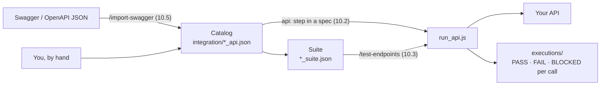
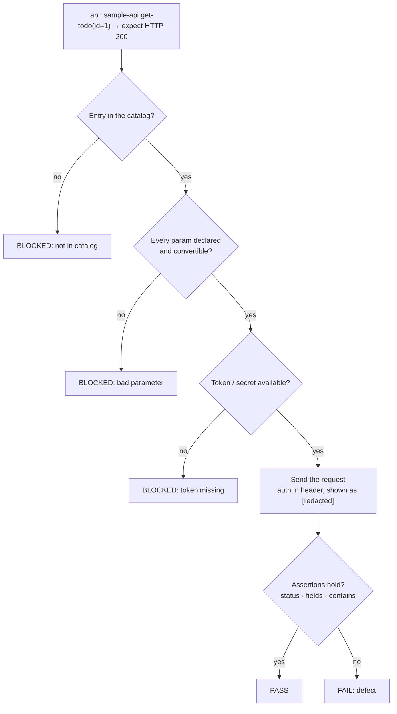

# 10. API testing

← [9. Mobile testing](./09-mobile-testing.md) · [Contents](./README.md) · Next: [11. Database checks →](./11-database-checks.md)

There are three ways to test APIs: `api:` steps inside a spec, a standalone pass over all API
suites, and generating everything from Swagger. They share one rule: **only cataloged requests
run**. The **catalog** is the list of requests you define in `integration/*_api.json`.



## 10.1 Step 1 — Define requests in the catalog

The sample `integration/sample_api.json` that `/init-test` creates:

```json
{
  "name": "sample-api",
  "baseUrl": "${API_BASE_URL}",
  "auth": { "type": "bearer", "tokenEnv": "API_TOKEN" },
  "requests": [
    { "name": "get-todo", "method": "GET", "path": "/todos/{id}", "params": ["id"],
      "description": "Fetch a todo by id — verify a record exists / has expected fields" },
    { "name": "create-todo", "method": "POST", "path": "/todos", "params": ["title"],
      "body": { "title": "{title}", "completed": false },
      "description": "Create a todo — example WRITE entry (seeding test data)" }
  ]
}
```

- A request is referenced as `<catalog name>.<request name>`, for example
  `sample-api.get-todo`. Names must be unique.
- `{id}` placeholders are filled from the step's parameters.
- The token comes from `API_TOKEN` in `.env`; the base URL from the environment's
  `api.baseUrl` ([4.3](./04-configuration.md#which-base-url-and-token-does-an-api-step-use) has the full rule).
- Writes (POST / PUT / DELETE) run if they are cataloged: **the catalog is the authorization**.

> **Production safety: read this before adding write requests.** Nothing in the runner checks
> whether `baseUrl` is production. A DELETE, refund or payment request in the catalog runs
> wherever the active environment points. Keep write requests in catalogs used only with test
> environments, never put production credentials in `.env` on a test machine, and review
> catalog changes in code review like any other code.

### Request bodies, auth headers and assertions

| What | How |
|------|-----|
| Typed body values | `"body": { "qty": { "$param": "qty", "type": "integer" } }`. Types: string, integer, number, boolean, json. A value that doesn't convert is BLOCKED. |
| Auth header | `auth.type`: `bearer`, `basic`, `apiKey` (a custom header: `{"type":"apiKey","headerName":"X-Api-Key","tokenEnv":"API_TOKEN"}`) or `none`. The value shows as `[redacted]` in logs. |
| Query parameters | List them in `"query": ["page"]`, or leave them out of the path and body. |
| Assertions | Status (`→ expect HTTP 200`), a field exists (`title present`), a field equals a value, a field contains text. |

## 10.2 Step 2 — Use api: steps in a spec

Mix them with UI steps, for example to prove a signup really created the user:

```markdown
## Scenarios
1. **Create a user via the UI** — fill the signup form and submit; expect a success state.
2. api: sample-api.get-todo(id=1) → expect HTTP 200 and title present
3. db:  sample-db.todo-by-title(title=qa-test-item) → expect 1 row
```

Or an API-only spec that needs **no browser**:

```markdown
# Spec: Catalog API smoke
Drivers: api

## Scenarios
1. api: shop-api.product-by-sku(sku=PRD-1) → expect HTTP 200 and name present
2. api: shop-api.stock-by-sku(sku=PRD-1) → expect HTTP 200 and quantity present
```

And a DB-only spec, also without a browser:

```markdown
# Spec: Todo data integrity
Drivers: db

## Scenarios
1. db: sample-db.todo-by-title(title=qa-test-item) → expect 1 row
```

Each step writes a PASS / FAIL / BLOCKED JSON result to the session's `logs/`. An entry that is
not in the catalog is **BLOCKED**, never guessed.



## 10.3 Standalone API pass — /test-endpoints

**Suite files** (`*_suite.json`, under `integration/api_test_suites/`) give each catalog entry
concrete parameters and expected results. The sample:

```json
{
  "name": "sample-api-suite",
  "cases": [
    { "name": "get-todo-happy-path", "entry": "sample-api.get-todo",
      "params": { "id": 1 },      "expect": { "status": 200, "fields": ["title"] } },
    { "name": "get-todo-not-found",  "entry": "sample-api.get-todo",
      "params": { "id": 999999 }, "expect": { "status": 404 } }
  ]
}
```

1. **Run** `/test-endpoints`. An `api-executor` subagent runs every case in every suite.
2. **Read** `executions/execu_<ts>/api-tests/result.md`: a PASS / FAIL / BLOCKED tally plus the
   defect list, with one evidence log per case.

Optional case fields:

| Field | Effect |
|-------|--------|
| `"auth": "none"` | Send with no credential, for example to test a 401. |
| `"omit": ["field"]` | Send without that field, for example to test a 400. |
| `"expect": {"fields": [...]}` | Dot-paths that must exist in the JSON response. |
| `"expect": {"contains": {"message": "token"}}` | Passes when the field includes the text. |

Example, a "no token" case:

```json
{ "name": "get-order-no-token", "entry": "orders.get-order", "auth": "none",
  "params": { "orderId": 1042 },
  "expect": { "status": 401, "contains": { "message": "token" } } }
```

## 10.4 The suite editor — /test-endpoints --edit

- A local page (on `127.0.0.1` only, with an access token per run) lists every suite under
  `integration/api_test_suites/`.
- Each value has a badge showing where it came from: UI · Project · Auto · Placeholder · Manual.
  Filters: Needs review / Failing / Skipped / Blocked.
- Edit a case in the side panel, then **Save**. If the file changed on disk in the meantime,
  Save refuses and keeps both versions.
- **Run all** or **Run this case** uses the same runner and writes the same evidence to
  `executions/`.
- Arabic is the default language; add `--lang=en` for English.

## 10.5 Generate tests from Swagger / OpenAPI

### Direct import

```
/import-swagger ./openapi.json --name acme-api
/import-swagger https://petstore3.swagger.io/api/v3/openapi.json
```

This generates a catalog and suite under `integration/api_test_suites/<service>/`. It supports
Swagger 2.0 and OpenAPI 3.x **JSON** (not YAML, not Postman). It maps fields, skips what it
can't infer and picks an auth scheme.

### The guided wizard (recommended)

```
/import-swagger --wizard ./openapi.json
```

1. **Swagger:** the spec URL or file, a suite name and the environment (no default; you pick).
2. **Endpoints:** every operation with its auth needs. DELETE and destructive writes start
   unselected.
3. **Test data:** Claude tries these sources in order and stops as soon as it finds values:
   - the project (past run logs and reports, newest first, then your test data files),
   - read-only DB queries from `integration/*_db.json`,
   - the chosen user's saved session (read only, no password),
   - the app's UI as the user you pick, reading real IDs and tokens from the app's own network
     calls. A captcha or OTP is handed to you.
   ```mermaid
   flowchart LR
     need["Values needed<br/>IDs · tokens · bodies"] --> p1{"1. Project files<br/>past runs, test data"}
     p1 -->|found| done["Use them"]
     p1 -->|not found| p2{"2. Read-only DB queries<br/>integration/*_db.json"}
     p2 -->|found| done
     p2 -->|not found| p3{"3. The user's saved session<br/>read only"}
     p3 -->|found| done
     p3 -->|not found| p4{"4. The app's UI<br/>as the user you pick"}
     p4 -->|found| done
     p4 -->|"captcha / OTP"| you["Handed to you"]
   ```

4. **Cases:** a preview of 4 checks per endpoint: happy path (2xx + required fields), not found
   (404), no token (401), missing required field (400).
5. **Approve:** one approval writes the catalog and suite (never over an existing file) and
   opens the editor. **"Approve and run now"** also runs the suite.

> **Where things land:** catalog and suite files are yours to commit. Collected values
> (`.agentex/cache/api-data/`) and captured tokens (`test/.auth/api-tokens/`) stay local and
> gitignored. Creating missing data through the UI needs your consent and an environment marked
> `"nonProduction": true`.

More: [docs/api-db-steps.md](../../api-db-steps.md) ·
[endpoint-testing skill](../../../skills/endpoint-testing/SKILL.md) ·
[swagger-import skill](../../../skills/swagger-import/SKILL.md).
