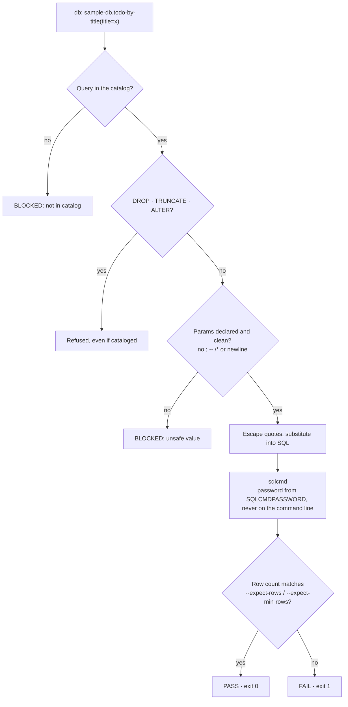

# 11. Database checks

← [10. API testing](./10-api-testing.md) · [Contents](./README.md) · Next: [12. UI check →](./12-ui-check.md)

"The UI says success, but did the row really get written?" `db:` steps answer that by running
**only the named queries you defined**, with values filled into their placeholders.

## 11.1 Step 1 — Define queries

`integration/sample_db.json`:

```json
{
  "name": "sample-db",
  "engine": "sqlserver",
  "connection": { "serverEnv": "DB_SERVER", "portEnv": "DB_PORT",
                  "databaseEnv": "DB_NAME", "userEnv": "DB_USER" },
  "queries": [
    { "name": "todo-by-title",
      "description": "Verify a todo row exists by title",
      "params": ["title"],
      "query": "SELECT TOP 1 Id, Title, Status FROM Todos WHERE Title = '{title}' ORDER BY Id DESC" }
  ]
}
```

The connection values come from the active environment's `db` block. The password comes only
from `SQLCMDPASSWORD` in `.env`.

## 11.2 Step 2 — Install sqlcmd

```
winget install -e --id Microsoft.Sqlcmd     # Windows (the modern go-sqlcmd)
sqlcmd "-?"                                 # check it works
```

AgenTeX currently targets SQL Server. On macOS or Linux, install Microsoft's `sqlcmd` for your
platform.

## 11.3 Step 3 — Use it in a spec

```
3. db: sample-db.todo-by-title(title=qa-test-item) → expect 1 row
```

Behind the scenes Claude runs the bundled runner, which you can also run yourself:

```
node "<plugin-root>/skills/db-integration/scripts/run_db.js" \
  --entry sample-db.todo-by-title --param title=qa-test-item \
  --expect-rows 1 --log "$SESSION_DIR/logs/s6-todo-by-title.log"
```

Assertions: `--expect-rows <n>`, `--expect-min-rows <n>`. Output: one JSON line with PASS /
FAIL / BLOCKED (exit codes 0 / 1 / 2).

## 11.4 Safety rules (enforced in code)



- **Catalog only:** Claude never writes its own SQL.
- **DDL refused:** `DROP`, `TRUNCATE` and `ALTER` are blocked **even if cataloged**.
- **How parameters work:** `{title}` is **substituted as text** into the SQL, not bound as a
  database parameter. The runner accepts only declared parameters, escapes quotes, and refuses
  values containing `;`, `--`, `/*` or a newline (BLOCKED). Keep cataloged queries read-only
  (`SELECT`) wherever possible.
- **The password** is never on a command line; `sqlcmd` reads `SQLCMDPASSWORD` itself.
- A bare `sqlcmd` command always asks you first (it is in the *ask* list).

More: [docs/api-db-steps.md](../../api-db-steps.md).
