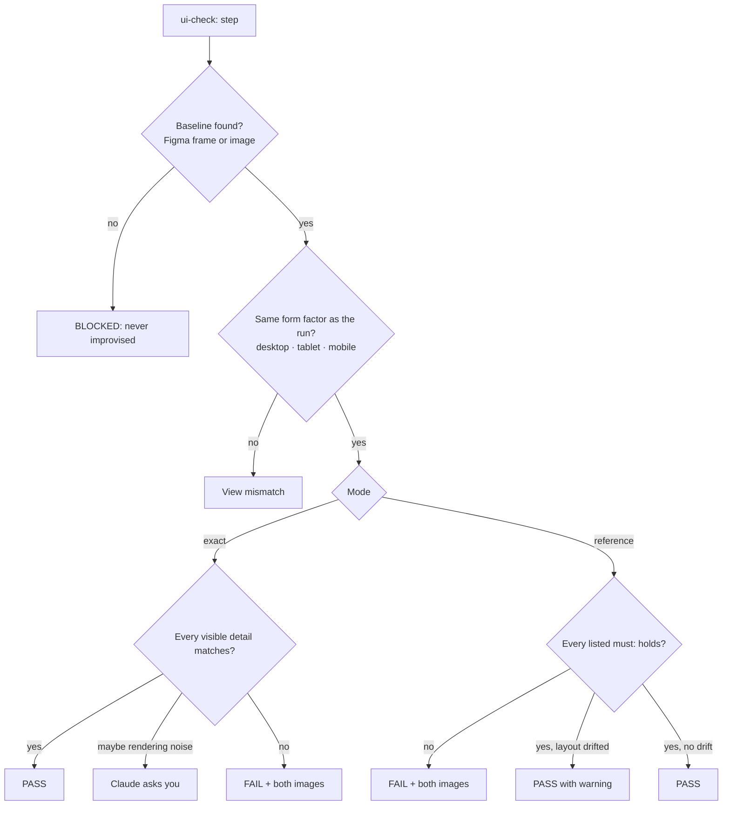

# 12. UI check: compare with Figma or a screenshot

← [11. Database checks](./11-database-checks.md) · [Contents](./README.md) · Next: [13. Ask the knowledge base →](./13-knowledge-base.md)

A `ui-check:` step compares the live page, at that exact point in the scenario, with a design
**baseline**: the picture of what the page should look like.

## 12.1 Syntax

```
ui-check: figma <node-id | frame URL> — mode: exact|reference [ — viewport: desktop|tablet|mobile|<W>x<H> ]
ui-check: image <path>                — mode: exact|reference [ — viewport: ... ]
```

## 12.2 Setup

| Source | In the spec | One-time setup |
|--------|-------------|----------------|
| `figma` | A node id (`123:456`) or the frame URL | `figma.fileKey` in `config/project.json` + `FIGMA_TOKEN` in `.env` |
| `image` | A path, for example `test/baselines/checkout-desktop.png` | None |

```json
"figma": { "fileKey": "AbCdEf123456", "token": { "envSecret": "FIGMA_TOKEN" } }
```

## 12.3 Modes

- **exact:** the page must match every visible detail. If a difference might be rendering noise
  (fonts, anti-aliasing, dynamic dates), Claude asks you before deciding.
- **reference:** only the listed details decide the verdict. General layout drift passes
  **with a warning**.

Example, reference mode:

```
ui-check: figma 123:456 — mode: reference
  - must: primary CTA reads "Pay now" and is enabled
  - must: order summary shows 3 line items with a total row
```



## 12.4 Viewports and results

- Defaults: desktop 1440×900, tablet 768×1024, mobile 390×844. Override them in
  `config/project.json` with `"viewports": { "mobile": "414x896" }`.

  ```mermaid
  xychart-beta
    title "Default viewport sizes (pixels)"
    x-axis ["desktop", "tablet", "mobile"]
    y-axis "Pixels" 0 --> 1500
    bar [1440, 768, 390]
    bar [900, 1024, 844]
  ```

  The first bar of each pair is the width, the second the height.
- The form factor must match: a mobile baseline against a desktop run is a **View Mismatch**,
  not PASS / FAIL.
- Both images (`…-ui-check-baseline.png` and `…-ui-check-actual.png`) are saved. A failure
  becomes a normal defect with both images attached.

> **Honest limit:** the verdict is a careful visual review, not a pixel-by-pixel comparison.
> Very small differences (1–2 px, nearly identical colors) can be missed.

More: [docs/ui-check.md](../../ui-check.md).
