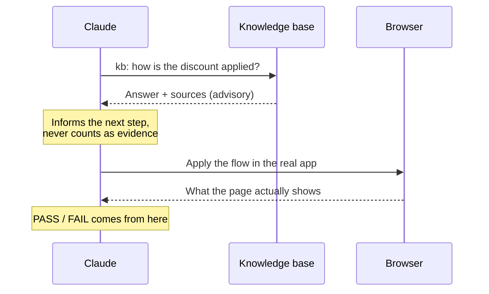

# 13. Ask the knowledge base

← [12. UI check](./12-ui-check.md) · [Contents](./README.md) · Next: [14. Jira Cloud →](./14-jira-cloud.md)

Ask your project's knowledge base (KB) a question in plain language, on its own or in the middle
of a test. The answer is **advisory only**: it informs testing but never counts as PASS / FAIL
proof.

## 13.1 Setup

In `config/project.json`:

```json
"kb": { "baseUrl": "http://localhost:3000", "project": "acme-store" }
```

In `.env`, if the KB server needs a key:

```
KB_ASK_API_KEY=...
```

## 13.2 Use it

```
/ask-kb how does the checkout flow work?
/ask-kb acme-store: what fields are required at checkout?
```

Inside a spec:

```markdown
## Scenarios
1. kb: how is a returning customer's discount applied at checkout?
2. **Verify** — apply the flow described above and confirm the discounted total in the UI.
```

Claude asks the KB first, then checks the real behavior in the browser. If the KB doesn't cover
the question, it says so plainly. Claude never queries the KB on its own initiative.



More: [docs/ask-kb.md](../../ask-kb.md).
