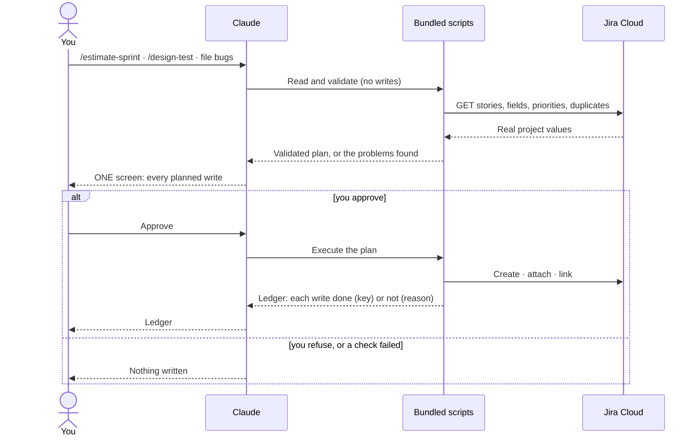
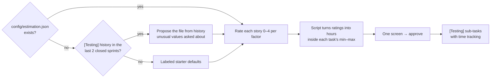
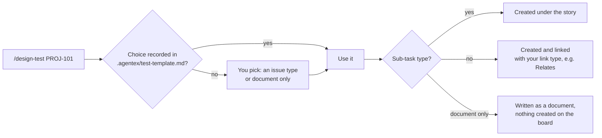

# 14. Jira Cloud

← [13. Ask the knowledge base](./13-knowledge-base.md) · [Contents](./README.md) · Next: [15. Azure DevOps →](./15-azure-devops.md)

Estimate QA effort, design test artifacts from acceptance criteria (ACs) and file bugs on Jira
Cloud. Everything goes through bundled scripts over the Jira REST API v3 (no `acli`, no npm
installs), always behind **one consolidated approval**: a single screen that lists every write
before anything is written.

Every Jira flow in this chapter follows the same shape: all reads and checks first, then one
screen, then the writes.



> **Before your first write on Jira:** Jira **reads** have been checked against a live site,
> but **creating** sub-tasks, test artifacts and bugs is covered by offline tests only so far.
> Try the first run on a test project, read the approval screen carefully, and check the
> result on the board afterwards.

## 14.1 One-time setup

1. **Run `/init-test`** and pick **Jira Cloud** at the tracker question (easiest). Or fill the
   block by hand in `config/project.json`:

   ```jsonc
   "jira": {
     "site": "yourteam",             // → https://yourteam.atlassian.net (or a full URL)
     "project": "PROJ",              // the project KEY
     "board": "PROJ board",          // optional: steers sprint discovery
     "assignee": "qa@company.com"    // optional default assignee(s)
   }
   ```

2. **Create an API token** at id.atlassian.com → Security → API tokens → Create API token.
3. **Put the credentials in `.env`:**

   ```
   JIRA_EMAIL=you@company.com
   JIRA_API_TOKEN=<paste the token>
   ```

4. **Done.** The `Bash(node:*)` permission already covers every Jira flow.

> **One tracker per project.** A config with both `azure` and `jira` blocks stops with "More
> than one tracker provider is configured". Keep exactly one.

## 14.2 What your Jira project needs

| Feature | Needed for · how to enable |
|---------|----------------------------|
| **Sprints** | `/estimate-sprint`. Team-managed: Project settings → Features → Sprints. Company-managed: use a Scrum board. Then **start** a sprint with stories. |
| **Time tracking** | Hours on `[Testing]` sub-tasks. The Time tracking field must be on the sub-task screen. If it isn't, sub-tasks are created without hours and the description says `Estimate: <n>h`; the approval screen warns you first. |
| **Bug type** | Bug filing. Add "Bug" to the project's work types. |

## 14.3 Estimate QA effort

```
/estimate-sprint                    # every story in the open sprint
/estimate-story PROJ-101 PROJ-102
```

1. **First run only:** with no `config/estimation.json` yet, the run reads the Original
   Estimates of `[Testing]` sub-tasks in your board's last **two closed sprints** and proposes
   the file (a min / max per task). Unusual values are listed with three choices: count it ·
   use the suggested value · type a number. No history → clearly labeled starter defaults.
2. **Rating.** Claude rates each story on the file's factors from 0 to 4. A script turns the
   ratings into hours inside each task's range. The same ratings always give the same hours.
3. **Questions.** Anything open (several open sprints, a story that already has tasks…) is
   asked in at most **one** question round.
4. **One screen, one approval.** You see the file, each story's ratings and hours, the sprint
   total and the exact write plan. Approve → `[Testing]` sub-tasks are created with time
   tracking and the label `testing`.



The estimation file format and an hours chart are in
[15.2](./15-azure-devops.md#152-estimate-a-sprint).

## 14.4 Design test artifacts — /design-test

```
/design-test PROJ-101
```

Jira has **no native Test Case type**. AgenTeX tells you so and asks what to create: one of your
project's real issue types (sub-task types are marked) or "document only". Steps are written as
an ordered action → expected list in the description. Artifacts that aren't sub-tasks link to
the story with a link type you choose (`Relates` recommended). Record your choice in
`.agentex/test-template.md` under `## Jira` so later runs skip the question.



## 14.5 File bugs after a run

1. **Ask:** *"File the defects from the last run as Jira bugs, parent story PROJ-101."*
2. **Validation.** Priority is checked against your project's real priority names. A severity
   custom field is used only if your Bug screen has one.
3. **Approve the plan.** Order: create the Bug → attach screenshots (an annotated copy with a red
   box and a label first) → link the story.
4. **Partial failure?** You get the created key, which attachments landed and the link state.
   Nothing is retried or cleaned up silently.

## 14.6 Known limitations on Jira

| Gap | What AgenTeX does |
|-----|-------------------|
| No test plans / runs API | Test-plan operations are refused upfront. During bug filing you can link to an existing `/design-test` artifact instead. |
| No "Tested By" link | Uses a link type you choose (`Relates`). |
| Delete is permanent | Delete is never offered. |
| Live writes not yet proven | Reads were checked live; creates are covered by offline tests. Check the first run's result on the board. |

Jira Server / Data Center is not covered.

## 14.7 Jira troubleshooting

| Message | Fix |
|---------|-----|
| "Jira is not fully configured — missing: jira.site / jira.project" | Fill the `jira` block or re-run `/init-test`. |
| "Jira credentials are incomplete" | Add both `JIRA_EMAIL` and `JIRA_API_TOKEN` to `.env`. |
| 401 / 403, or "answered anonymously with a 404" | The email must belong to the account that created the token. Regenerate the token. |
| "no Story sits in an open sprint" | A Kanban board, no started sprint, or an empty sprint. Or estimate by key instead. |
| Unexpected "no duplicates found" / empty results | Jira may be answering anonymously. Check the credentials first. |

More: [docs/jira.md](../../jira.md).
