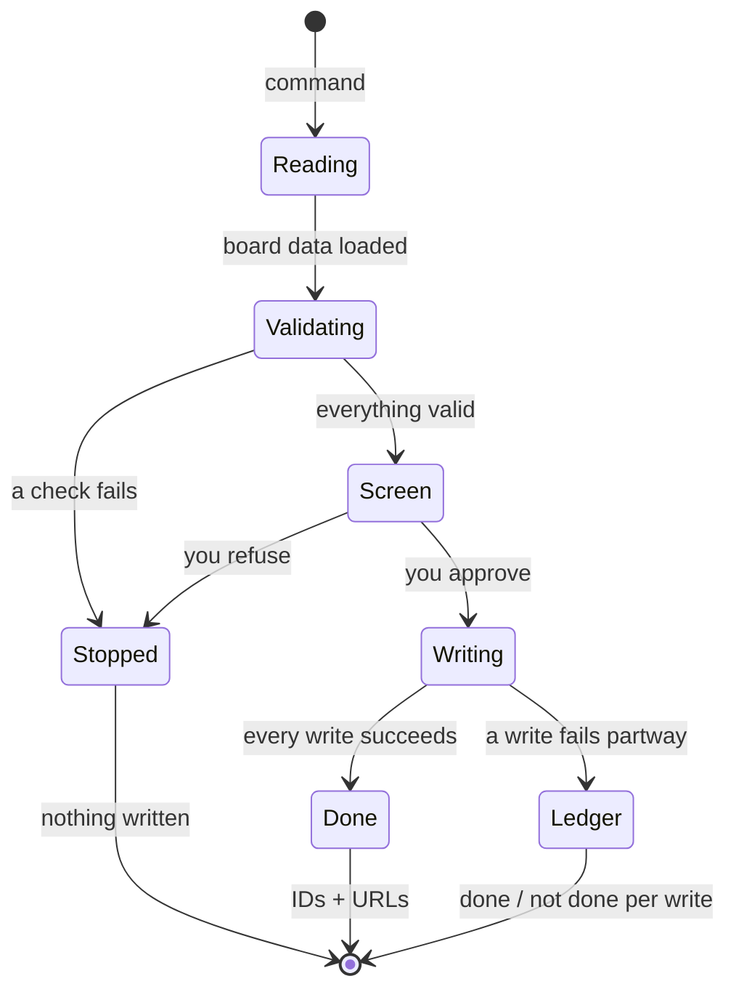
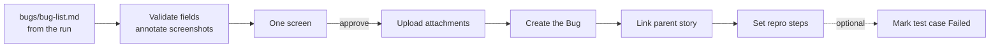

# 15. Azure DevOps

← [14. Jira Cloud](./14-jira-cloud.md) · [Contents](./README.md) · Next: [16. Reports and evidence →](./16-reports-and-evidence.md)

The same flows on Azure DevOps (ADO): estimation, test case design and bug filing, plus reading
Azure resources during a run. Board flows use bundled scripts over the ADO REST API; **no Azure
CLI is needed** for them.

## 15.1 One-time setup

1. **Fill the `azure` block** in `config/project.json` (or pick Azure DevOps in `/init-test`):

   ```jsonc
   "azure": {
     "org": "my-org",                 // bare name or https://dev.azure.com/my-org
     "project": "MyProject",
     "team": "MyProject Team",
     "assignee": "qa@company.com"
   }
   ```

   Optional extras: `areaPath`, `iterationPath`, `bugTemplateId`, `testPlanId`, `valueArea`,
   `environment`, `bugCategory`, `apiVersion`.

2. **Create a Personal Access Token (PAT)** in Azure DevOps (User settings → Personal access
   tokens). The repository does not list required scopes. A practical starting point is Work
   Items (read & write), plus Test Management if you mark test cases Failed. Give it the
   shortest expiry your team allows.
3. **Put it in `.env`:** `AZURE_PAT=<token>`. That's the whole setup. The scripts read it
   themselves and send it only in the Authorization header.

## 15.2 Estimate a sprint

```
/estimate-sprint                          # every User Story in the current sprint
/estimate-story 12345 12346               # named stories
/estimate-sprint read the last 3 sprints  # first-run proposal from 3 sprints
```

Your team's method lives in `config/estimation.json` (commit it). The starter defaults, used
when there is no history:

```json
{
  "schemaVersion": 1,
  "tasks": [
    { "name": "Requirement Review",    "enabled": true, "minHours": 0.5, "maxHours": 1 },
    { "name": "Test Creation",         "enabled": true, "minHours": 0.5, "maxHours": 1 },
    { "name": "Test Execution",        "enabled": true, "minHours": 1,   "maxHours": 1.5 },
    { "name": "Bug Review and Retest", "enabled": true, "minHours": 0.5, "maxHours": 1 },
    { "name": "Automation",            "enabled": true, "minHours": 0.5, "maxHours": 0.5 }
  ],
  "factors": {
    "Scenarios / ACs": 1, "UI elements": 1, "Validations": 1, "Conditions / logic": 1,
    "Error messages": 1, "API integrations": 1, "Translations": 1, "Edge cases": 1
  },
  "source": { "kind": "starter-defaults" }
}
```



```mermaid
xychart-beta
  title "Starter defaults: hours per [Testing] task"
  x-axis ["Requirement Review", "Test Creation", "Test Execution", "Bug Review & Retest", "Automation"]
  y-axis "Hours" 0 --> 2
  bar [0.5, 0.5, 1, 0.5, 0.5]
  bar [1, 1, 1.5, 1, 0.5]
```

The first bar of each pair is `minHours`, the second `maxHours`. A story's ratings decide where
each task lands between them.

That is 3 h per story when every task is at its minimum and 5 h at its maximum. Task titles
become `[Testing] Requirement Review` and so on. Edit names, ranges and weights freely; unknown
keys or `minHours > maxHours` stop the run with every problem named.

- **First run:** the file is proposed from the Original Estimates of `[Testing]` tasks in the
  team's last two closed iterations (values over 3× or under ⅓ of normal are flagged).
- **Each story:** rated 0–4 per factor; hours are placed inside each task's min–max range.
- **One approval** writes the file (on the first run) and creates each task together with its
  parent link in one step, so a task without a parent cannot exist.
- **Rebuild from history:** delete or move `config/estimation.json`.

## 15.3 Design test cases

```
/design-test 12345
```

1. **Analyze.** Claude reads the story's acceptance criteria and breaks them into test
   conditions, one test case per condition.
2. **Conventions.** Persona, journey steps, setup steps and languages come from
   `.agentex/test-template.md` (created on the first run).
3. **Validate, with zero writes.** It confirms the story is a real User Story, checks for
   duplicate titles (a check that can't complete blocks the run), and compiles the steps into
   ADO's Steps format.
4. **One screen:** the conditions table, the titled cases with step summaries, the duplicate
   results and the write plan.
5. **Approve** → each case is created with its **Tested By** link, then a coverage check confirms
   every acceptance criterion is covered.

## 15.4 Approval and the ledger

All three flows end the same way: **one consolidated screen, one approval**. If something fails
partway, you get an exact **ledger**: every planned write shown as done (ID + URL) or not done
(reason). Nothing is retried or cleaned up without you.



## 15.5 File bugs after a run

1. **Ask:** *"File the defects from the last run as Azure bugs under story 12345."*
2. **Resolve.** The template, parent story, assignee and environment come from config and the
   run; at most one question round.
3. **Validate.** The parent story exists, there is no duplicate with the same title, and
   severity / priority / picklists match your project's real values. Screenshots are checked
   and annotated.
4. **Review the screen.** It shows the recommended severity / priority with the reasoning, the
   evidence list and the write plan.
5. **Approve.** Order: upload attachments → create the Bug → link the parent story → set the
   repro steps. Optionally mark the related test case **Failed**.



> **Field cache:** valid picklist values are cached in
> `.agentex/cache/tracker-fields-ado.json`. After an admin changes your process, ask Claude to
> *"refresh the tracker field cache"*.

## 15.6 Reach Azure resources mid-run

With the `az` CLI installed and logged in (`az login`), you can ask during a test:

```
"Check if the latest deployment succeeded."
"Tail the App Service logs while I run the checkout scenario."
"Does the export blob exist in the reports container?"
```

Read-only commands (`az webapp show / log`, `storage blob list`, `keyvault secret list`,
`aks list` …) are pre-approved. Deploy, upload, `aks get-credentials` and `group create` always
ask first. Secret values are never printed; Claude only confirms that they exist.

More: [docs/azure-devops.md](../../azure-devops.md).
