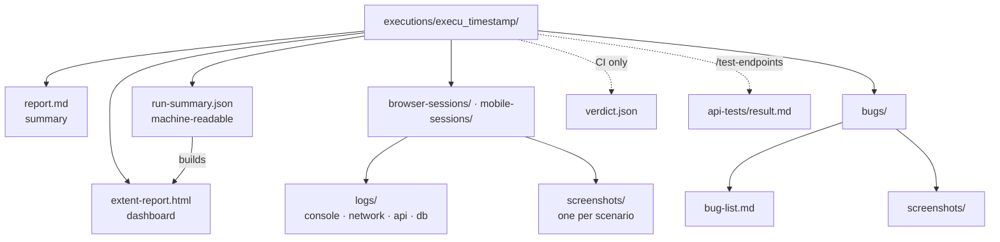
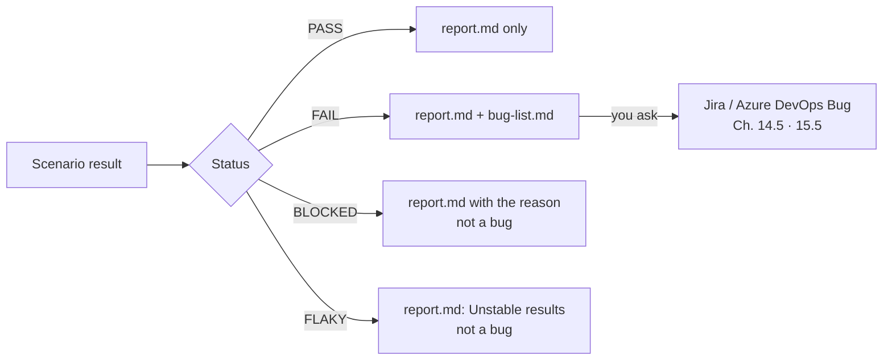
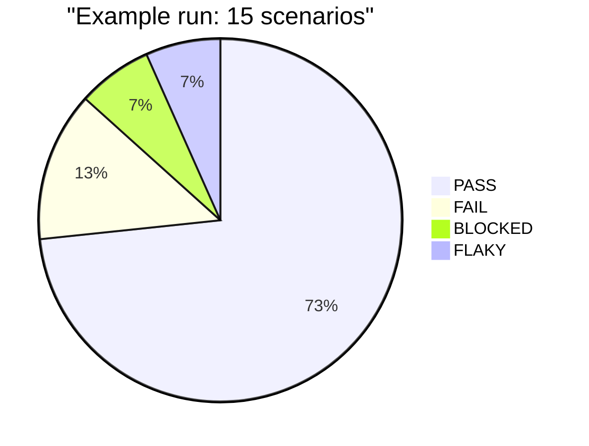

# 16. Reports and evidence

← [15. Azure DevOps](./15-azure-devops.md) · [Contents](./README.md) · Next: [17. CI quality gate →](./17-ci-quality-gate.md)

Every run creates a new timestamped folder, `executions/execu_<timestamp>/`. You never create it
by hand.

| File | What it is |
|------|------------|
| `report.md` | The consolidated summary: what passed, failed or was blocked, and why. |
| `extent-report.html` | A dark-themed dashboard: donut chart, status cards, expandable test cases with step details. All CSS / JS is inlined, so you can email it or attach it to a ticket. |
| `bugs/bug-list.md` | The merged defect list, ready for bug filing. |
| `browser-sessions/…` / `mobile-sessions/…` | Logs and one screenshot per scenario. |
| `api-tests/result.md` | The standalone API pass tally (`/test-endpoints`). |
| `run-summary.json` | The machine-readable run summary the dashboard is built from. Keep it. |
| `verdict.json` | CI runs only: the machine-readable verdict. |



## 16.1 What a reported defect looks like

Every defect in `report.md` and `bugs/bug-list.md` has the same format. An example for the
signup sample:

```
Title:    Signup accepts a 3-character password without an error
Steps to reproduce:
  1. Open https://example.com/signup
  2. Fill Name "QA Tester", email qa.tester@example.com, password "abc"
  3. Click "Sign up"
Expected: A visible password length/strength error; the form does not submit
Actual:   The form submits and the success page is shown
Severity: High
Evidence: browser-sessions/<session>/screenshots/s4-weak-password.png;
          console: no errors; network: POST /api/signup → 201
```

A **FLAKY** result (failed, then passed on retry) is listed separately under "Unstable results"
and never goes into `bug-list.md`.

Where each result goes:



## 16.2 The dashboard

The dashboard opens with a verdict banner and a donut chart of the run's statuses, like this
example run of 15 scenarios:



Below it are a card per status and an expandable card per test case with every step.

The dashboard is generated for you at the end of every run. To regenerate it by hand, the
script takes the run-summary JSON and an output path (see
[3.8](./03-installation.md#38-running-bundled-scripts-yourself-the-plugin-path) for `<plugin-root>`):

```
node "<plugin-root>/skills/extent-report/scripts/make_html_report.js" \
  executions/execu_<ts>/run-summary.json executions/execu_<ts>/extent-report.html
```

Run it from your **project root**. Easier: ask Claude *"regenerate the extent report for the
last run"*.

> **Committing runs? Check the screenshots first.** `executions/` is **not** ignored by default,
> because many teams want their evidence history in git. The secret scan skips screenshots, so
> review them for tokens or personal data. To keep runs local, add `executions/` to
> `.gitignore`.

More: [docs/extent-report.md](../../extent-report.md).
