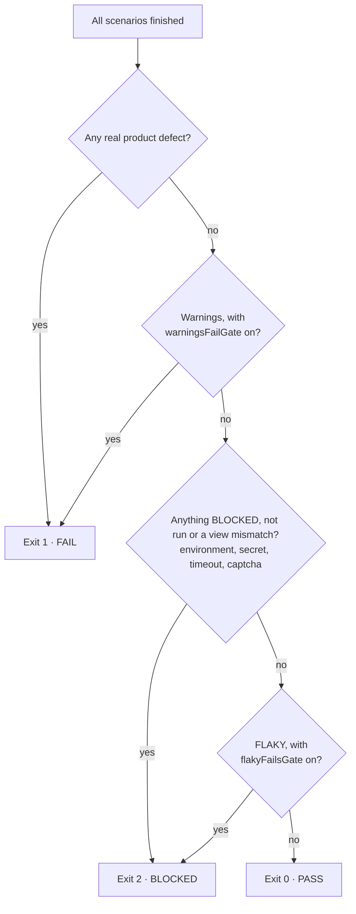
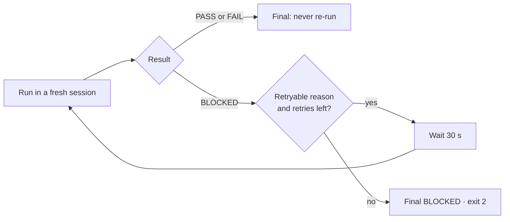
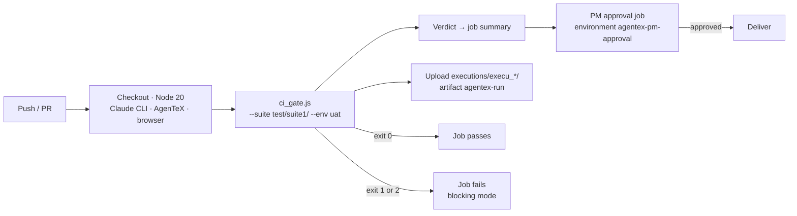

# 17. CI quality gate

← [16. Reports and evidence](./16-reports-and-evidence.md) · [Contents](./README.md) · Next: [18. Git and security →](./18-git-and-security.md)

Run a suite from your pipeline, headless, with no user interaction, and gate delivery on a
reliable verdict.

## 17.1 Exit codes: the contract

| Exit | Verdict | Meaning |
|------|---------|---------|
| **0** | PASS | Every scenario met expectations (an expected failure in a negative spec counts as a pass). |
| **1** | FAIL | **Real product defects** only, or warnings while `warningsFailGate` is on. |
| **2** | BLOCKED | **Environment / infrastructure**: an unreachable target, a missing secret, a timeout, a captcha, a session that never finished. |

**The promise:** an environment failure never produces exit 1, and a real defect is never hidden
behind an environment excuse.



## 17.2 The command

Run it from the root of your AgenTeX project:

```
node "<plugin-root>/skills/test-execution/scripts/ci_gate.js" --suite test/suite1/ --env uat
```

| Option | Meaning |
|--------|---------|
| `--spec <file>` (repeatable) · `--suite <folder>` · `--all` | The scope. Give exactly one. |
| `--env <name>` | The environment file to use. |
| `--retries 3` | How often a BLOCKED result is retried. |
| `--timeout-minutes 60` | The time limit per run. |
| `--warnings-fail true` | Count warnings as FAIL. |
| `--flaky-fails-gate false` | Whether a flaky result fails the gate. |

Policy comes from flags first, then `config/project.json`, then the defaults.

stdout carries exactly **one JSON line** (the verdict); diagnostics go to stderr. Most BLOCKED
results are retried automatically (up to 3 times by default, 30 s apart, each in a fresh
session); PASS and FAIL are never re-run.

| BLOCKED reason | Retried? |
|----------------|----------|
| Target unreachable, timeout, missing secret, `no-verdict` with an unknown cause… | Yes |
| `session-error` / `not-authenticated` (no Claude credential) | **No**: set `ANTHROPIC_API_KEY` |
| `no-verdict` / `tool-denied` (the CI settings deny a tool) | **No**: add the allow rule to `ci-settings.json` |
| `preflight-driver` (a `Drivers: mobile` spec is in scope) | **No**: remove mobile specs from the CI scope |
| `unstable` (flaky, with `flakyFailsGate` on) | **No**, by design |



## 17.3 Runner prerequisites

1. **Node 20+ and the Claude CLI:** `npm install -g @anthropic-ai/claude-code`, with
   `ANTHROPIC_API_KEY` (or Bedrock / Vertex credentials) from your secret store.
2. **The AgenTeX plugin** installed, or a pinned checkout of the repository as `<plugin-root>`.
3. **The browser driver** in the project:
   `npm install -D @playwright/cli && npx playwright-cli install-browser chromium`.
4. **Every `envSecret` name** injected as an environment variable from the secret store. A CI
   runner has no `.env`.

## 17.4 Example: GitHub Actions

Copy the template
[`skills/test-execution/templates/ci/github-actions.yml`](../../../skills/test-execution/templates/ci/github-actions.yml)
to `.github/workflows/agentex-gate.yml` and replace every `<placeholder>`. The job's steps, in
order:

```yaml
- uses: actions/checkout@v4
- uses: actions/setup-node@v4
  with: { node-version: 20 }
- run: npm install -g @anthropic-ai/claude-code
- run: claude plugin install <agentex@your-marketplace>
- run: npm install -D @playwright/cli && npx playwright-cli install-browser chromium
- name: AgenTeX gate
  # continue-on-error: true   # ADVISORY mode: a PM approval becomes the gate
  env:
    ANTHROPIC_API_KEY: ${{ secrets.ANTHROPIC_API_KEY }}
    QA_PASSWORD:       ${{ secrets.QA_PASSWORD }}
    API_TOKEN:         ${{ secrets.API_TOKEN }}
  run: node "<plugin-root>/skills/test-execution/scripts/ci_gate.js" --suite test/suite1/ --env uat
```

The template then writes the verdict to the job summary and uploads `executions/execu_*/` as the
`agentex-run` artifact. A second job waits for a PM approval: create an environment named
`agentex-pm-approval` in **repo Settings → Environments** and add **Required reviewers**,
otherwise it passes without anyone approving. Set the job's `timeout-minutes` above
`(1 + retries) × timeoutMinutes`.



In **advisory mode** (`continue-on-error: true` on the gate step) a red gate does not stop the
pipeline, and the PM approval becomes the gate.

For Azure Pipelines use
[`templates/ci/azure-pipelines.yml`](../../../skills/test-execution/templates/ci/azure-pipelines.yml)
(with a `ManualValidation` PM approval step). Publish `executions/execu_*/` as the artifact.
**Never publish `test/.auth/`.**

## 17.5 CI mode rules

- **No questions:** anything that needs a human becomes BLOCKED, with the exact question in
  `blockedReasons`.
- **No tracker writes:** bug filing stays interactive; file the bugs from `bugs/bug-list.md`
  later.
- **Passwords** declared as `envSecret` are typed by `fill_secret.js`; the session never sees the
  value. A missing one → `secret-unavailable`.
- **Mobile specs** are not run by the browser gate (`preflight-driver`).
- **Team policy** can live in `config/project.json`:
  `"ci": { "warningsFailGate": true, "retries": 3, "timeoutMinutes": 60, "flakyFailsGate": false }`.

More: [docs/ci-quality-gate.md](../../ci-quality-gate.md).
