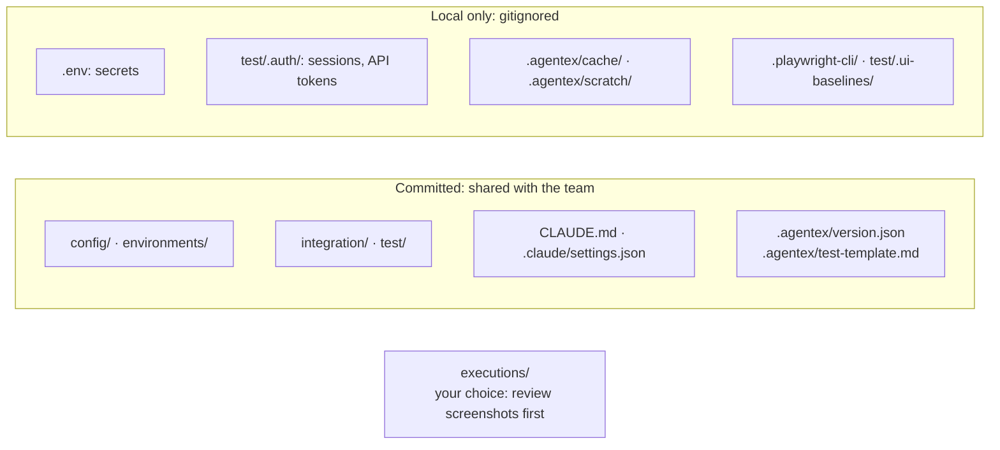
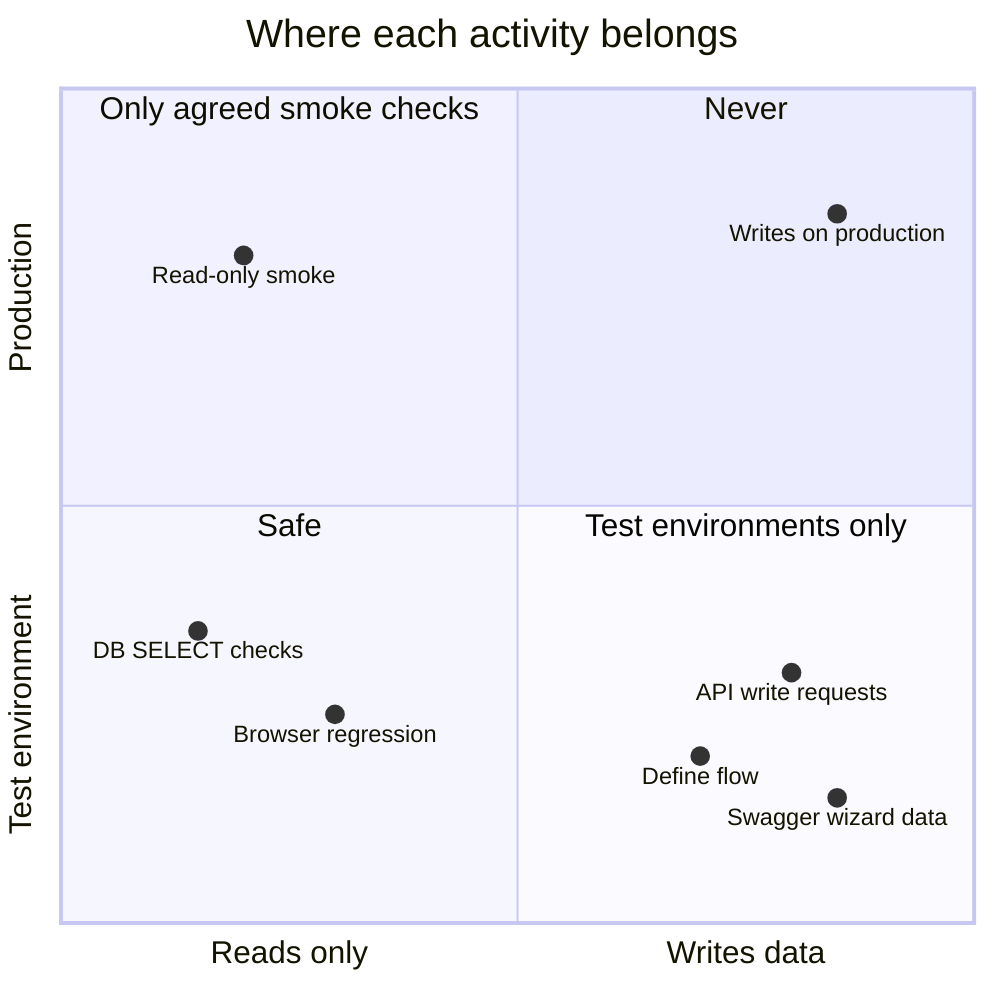

# 18. Git and security

← [17. CI quality gate](./17-ci-quality-gate.md) · [Contents](./README.md) · Next: [19. Keeping your project up to date →](./19-keeping-up-to-date.md)

## 18.1 What to commit

| Commit | Keep local (gitignored) |
|--------|-------------------------|
| `config/project.json`, `config/estimation.json`, `environments/*.json` (**after review**: no real customer data, phone numbers or plain-text passwords), `integration/`, `test/` specs, `test/baselines/`, `CLAUDE.md`, `.claude/settings.json`, `.agentex/version.json`, `.agentex/test-template.md` | `.env`, `test/.auth/` (saved sessions and API tokens), `.playwright-cli/`, `test/.ui-baselines/`, `.agentex/cache/`, `.agentex/scratch/` |



## 18.2 Environment safety

| Environment | Recommended use | Restrictions |
|-------------|-----------------|--------------|
| **QC / dev** | Everything: sequential, parallel, define-flow, API writes, the Swagger wizard. | Can be marked `"nonProduction": true`. |
| **UAT / staging** | Regression, the CI gate, mostly read-only API / DB checks. | Review cataloged write requests first; use shared QA accounts only. |
| **Production** | Not recommended. At most read-only smoke checks, agreed with the owner. | No write requests in the catalog, no `/define-flow`, never `nonProduction`, no production credentials on test machines. |



## 18.3 Secret scan and pre-commit hook

- The plugin **never sets a remote and never pushes**. Add your remote yourself, with a URL that
  carries no credentials:
  `git remote add origin https://git.example.com/team/qa-project.git`.
- `/init-test` offers an optional **pre-commit hook** that runs the secret scan and refuses a
  commit that leaks a secret.

  ```mermaid
  flowchart LR
    gc["git commit"] --> hook{"Pre-commit hook<br/>installed?"}
    hook -->|no| done["Committed, unchecked"]
    hook -->|yes| scan["secret_scan.js --staged"]
    scan --> f{"Findings?"}
    f -->|"leak: secret-value · env-file-tracked · remote-credential"| refuse["Commit refused<br/>move the value to .env"]
    f -->|"warning: plain-secret-field"| warn["Committed, with a warning"]
    f -->|none| ok["Committed"]
  ```
- **Screenshots are not scanned.** The secret scan skips binary files, so a screenshot that
  shows a token, a customer's data or an OTP can reach git if you commit `executions/`. Review
  evidence before committing it, or add `executions/` to `.gitignore`.
- **Narrow `Bash(node:*)`** on shared or production-adjacent machines. It allows *any* node
  command, not just AgenTeX's scripts (see [3.5](./03-installation.md#35-set-permissions-important)).
- **Test against non-production environments.** Cataloged API writes and the `/define-flow`
  steps you approve really run. Only mark an environment `"nonProduction": true` if it truly is.
- The scan reports leaks (`secret-value`, `env-file-tracked`, `remote-credential`) and warnings
  (`plain-secret-field`). Fix them by moving the value into `.env` and referencing it with
  `envSecret`.

More: [docs/putting-your-project-in-git.md](../../putting-your-project-in-git.md).
