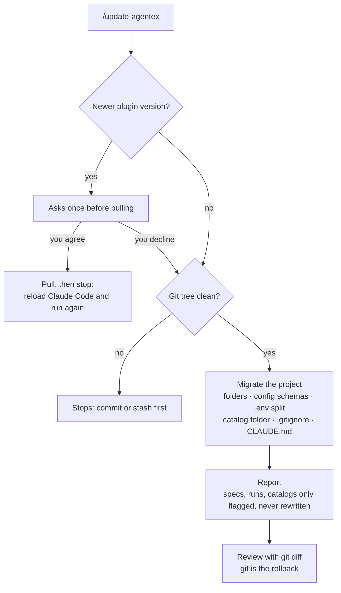

# 19. Keeping your project up to date

← [18. Git and security](./18-git-and-security.md) · [Contents](./README.md) · Next: [20. Troubleshooting and FAQ →](./20-troubleshooting-and-faq.md)

When AgenTeX is updated, its conventions (folder layout, config file shapes) can change.
`/update-agentex` moves your project to the new conventions without losing your values.

1. **Commit or stash your changes.** `/update-agentex` needs a clean git tree, because git is the
   way back if you don't like the result.
2. **Run `/update-agentex`.** It first checks for a newer plugin version and asks once before
   pulling it. After a pull, reload Claude Code and run it again.
3. **Migration.** The folder structure, config schemas, the secrets-only `.env` split, the
   catalog folder, `.gitignore` and `CLAUDE.md` are updated. **Your values are carried over,
   never reset.**
4. **Review the report.** Specs, old runs and filled-in catalogs are never rewritten; anything
   in them that no longer matches the conventions is only flagged.

It is safe to run again: a project that is already up to date reports "already up to date" and
writes nothing. `.agentex/version.json` records the version the project matches.

More: [docs/configuration.md](../../configuration.md).
