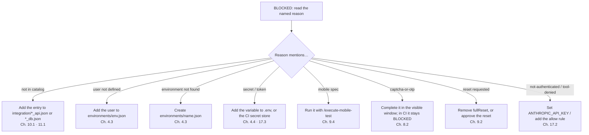

# 20. Troubleshooting and FAQ

← [19. Keeping your project up to date](./19-keeping-up-to-date.md) · [Contents](./README.md) · Next: [Glossary →](./glossary.md)

## 20.1 Common problems

| Problem | What to do |
|---------|------------|
| Claude asks permission before every browser command | Copy the `permissions` block into `.claude/settings.json` ([3.5](./03-installation.md#35-set-permissions-important)). |
| A step is BLOCKED "not in catalog" | Add the request or query to `integration/*_api.json` or `*_db.json` first; names must match exactly. |
| A step is BLOCKED: user not defined | Add the user handle under `users` in the active `environments/<env>.json`. |
| "Environment uat not found" | Create `environments/uat.json`. A missing environment is never silently replaced. |
| A mobile spec is BLOCKED in `/execute-test` | Correct behavior: run it with `/execute-mobile-test`. |
| `webdriverio not found` | Run `npm install -D webdriverio` in your project. |
| An Appium session fails | Is the server running (`npx appium server`)? Is the device in `adb devices`? Is the driver installed (`npx appium driver list`)? |
| A saved login no longer works | Nothing to do: the run logs in again and saves a fresh session. Apps that keep login in IndexedDB cannot be resumed. |
| A captcha / OTP appears during a run | Complete it in the visible browser window. In CI it is BLOCKED `captcha-or-otp`. |
| The Swagger file is YAML | Convert it to JSON, or use the JSON endpoint (for example `/v3/api-docs`, `/swagger.json`). |
| The tracker rejects a field value | Ask Claude to "refresh the tracker field cache". |
| CI exit 2 with `tool-denied` | Add a matching allow rule to your `ci-settings.json`. |
| CI exit 2 with `not-authenticated` | Set `ANTHROPIC_API_KEY` on the gate step. |

### A step or run is BLOCKED: where to look

## 20.2 Supported, not supported, experimental

| Area | Status | Notes |
|------|--------|-------|
| Browser (Chromium via playwright-cli) | Supported | Sequential, parallel, CI. |
| Android / iOS native apps | Supported | Not run by the CI gate; iOS needs macOS. |
| API: OpenAPI 3.x / Swagger 2.0 JSON | Supported | YAML and Postman collections are not supported. |
| Database: SQL Server | Supported | Other engines (PostgreSQL, MySQL) not yet. |
| Azure DevOps boards | Supported | Estimation, test design, bugs, marking a test case Failed. |
| Jira Cloud | **Writes experimental** | No test plans / runs, no Tested-By link, no delete; Jira Server / Data Center not covered. |
| UI check | Supported | Visual judgment, not a pixel diff. |
| Session reuse | Supported | Not for logins kept in IndexedDB. |
| Captcha / an OTP you can't get | Not supported (by design) | A human step when interactive, BLOCKED in CI. |

## 20.3 Frequently asked questions

**Does AgenTeX change my application?**
Not by design: test runs write to `executions/`, and setup commands write AgenTeX's own project
files ([1.2](./01-what-is-agentex.md#12-safety-guarantees-and-what-enforces-each-one) lists them).
The guarantee is enforced only when the `Edit(...)` deny rule points at your real source folder.

**Can it see my passwords?**
Not if you copied the permission rules: they deny reading `.env`. The bundled scripts read the
values themselves and send them only in headers, or type them via `fill_secret.js`.

**Sequential or parallel?**
Sequential for new or exploratory testing, where you want to watch and steer. Parallel for
regression suites you trust.

**Can one spec mix UI, API and DB?**
Yes. A browser spec can contain `api:`, `db:`, `kb:` and `ui-check:` lines.

**Will it write to Jira / Azure without asking?**
Never. Every tracker flow ends at one consolidated approval screen, and CI mode blocks all
tracker writes.
