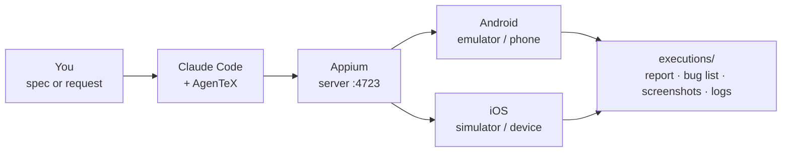

# 1. How it works

[Your path](./README.md) · Next: [2. Setup in 4 steps →](./02-setup.md)

You describe the test. Claude drives the app through Appium. You get proof for every step.

| Step | What happens |
|------|--------------|
| **1. You write** | A markdown spec, or just "test the login screen". No code, no locators. |
| **2. Claude plans** | It lists the scenarios and waits for your approval. Nothing runs before you agree. |
| **3. Appium drives** | Taps, types and swipes on a real device, and reads `logcat`. A crash in the log is a defect. |
| **4. You get proof** | A screenshot per scenario, logs, and bugs already written up, ready for Jira or Azure DevOps. |

> **Two modes.** **Sequential** (the default): you approve each step. **Parallel**: one spec file
> per device, no pauses. See [Run at scale](./06-run-at-scale.md).

> **Your data is safe.** App data is never reset without your OK. Destructive device commands
> (uninstall, clear data, reboot) always ask first.
