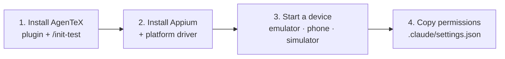

# 2. Setup in 4 steps

← [1. How it works](./01-how-it-works.md) · [Your path](./README.md) · Next: [3. Point it at your app →](./03-point-it-at-your-app.md)

Do this once per machine and project. Android works on Windows, macOS and Linux; iOS needs a Mac
with Xcode.



## 1. Install AgenTeX

```
/plugin marketplace add MhmdElGazzar/elgazzar-plugins
/plugin install agentex@elgazzar-plugins
/init-test
```

## 2. Install Appium and a driver

```
npm install -D appium
npx appium driver install uiautomator2    # Android
npx appium driver install xcuitest        # iOS
```

## 3. Start a device and check it

```
emulator -avd <name>              # or start it from Android Studio
adb devices                       # → emulator-5554
xcrun simctl boot "iPhone 15"     # iOS
```

## 4. Copy permissions

Copy the `permissions` block from the repository's
[`settings.example.json`](../../../settings.example.json) into your project's
`.claude/settings.json`. Read-only device commands then run freely; uninstall, clear data and
reboot always ask first.

> **You don't need to start Appium yourself.** Claude starts `npx appium server` when a run needs
> it. To check it by hand: `curl -s http://127.0.0.1:4723/status`.
