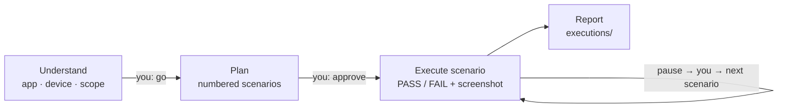

# 4. Your first run

← [3. Point it at your app](./03-point-it-at-your-app.md) · [Your path](./README.md) · Next: [5. Write a spec →](./05-write-a-spec.md)

One command. Claude stops at every checkpoint, so you stay in control.

```
/execute-mobile-test suite1

# or in plain English:
Test the login screen of our Android app — happy path plus wrong password and empty fields.
```



Every step is captured: a screenshot, the Appium log and `logcat`.

> **No app yet? Use ApiDemos.** It is the official Appium sample app (`io.appium.android.apis`,
> `ApiDemos-debug.apk` from the `appium/android-apidemos` repository). AgenTeX ships a ready spec
> for it, `apidemos-navigation.md`: open Views → back → open Graphics → back, and fail on any
> crash. Put the `.apk` path in your `mobile` block, run the command, and say *"run only
> apidemos-navigation.md"*. If it passes, your whole setup works.
