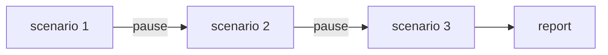
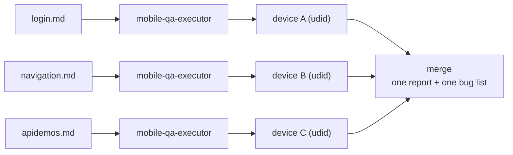

# 6. Run at scale and read the results

← [5. Write a spec](./05-write-a-spec.md) · [Your path](./README.md) · Next: [7. If something breaks →](./07-troubleshooting-and-cheat-sheet.md)

## Sequential (the default)

`/execute-mobile-test suite1`: one device, and you approve each step.



## Parallel

*"Run a parallel regression … from the specs in test/mobile-suite1/"*: no pauses.



> **One device per session.** Parallel needs a separate emulator, simulator or phone for each
> spec file. You probably have 1–2, not 8.

## Where the results land

```
executions/execu_<timestamp>/
├── report.md              # tally + defects
├── extent-report.html     # dashboard
├── mobile-sessions/run/
│   ├── logs/              # Appium + logcat
│   └── screenshots/
└── bugs/bug-list.md
```

## A defect, already written (example)

```
Title:    App crashes on empty login
Steps:    1. Launch app  2. Leave fields empty  3. Tap "Login"
Expected: "required" errors
Actual:   app closes; logcat shows FATAL EXCEPTION
Severity: Critical
Evidence: s3-empty-fields.png
```

Then say *"File the defects from the last run as bugs under story 12345"*. AgenTeX validates
every field against Jira or Azure DevOps and writes nothing until you approve.
